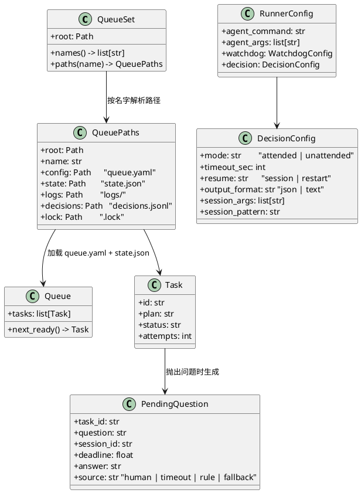

# overnight-runner：多队列目录 + TUI 交互式决策

> 日期：2026-11-06
>
> 关联需求：用户口述两条 —— ①「.overnight-runner 中创建一个 queue 的目录，可以启动不同的 queue 用于多个人使用」；②「可以做到在 TUI 中允许输入决策吗？这样白天使用的时候搞一个等待窗口，如果没有及时给出决策就帮我决策」
>
> 设计 design：`overnight-runner/docs/design.md`
>
> **plan 一旦定稿就不修改。** 同一资源的二次改造新建 `YYYYMMDD-{slug}.md`，不修改原计划文件
>
> **放置位置说明**：本仓库此前没有 `docs/` 目录。按 `AGENTS.md` §14 第 2 步的约定，
> 本次新建 `docs/plans/` 存放 harness 仓库自身的开发计划（业务项目的计划仍在
> `example-project/docs/plans/`）。

## 1. 文档说明

### 1.1 背景

`overnight-runner` 目前是 **单队列、单决策** 的设计：

```
<project>/
├── overnight-runner.yaml        # runner 配置 + queue 任务列表（混在一起）
└── .overnight-runner/
    ├── project.yaml              # 默认决策规则、提示词
    ├── state.json                # 运行时状态
    ├── logs/                     # agent 日志
    └── decisions.jsonl           # 决策记录
```

这带来三个实际用不了的问题：

| # | 问题 | 复现 | 影响 |
|---|---|---|---|
| 1 | **只能有一条队列** | 队列定义写死在项目根的 `overnight-runner.yaml` 的 `queue:` 段 | 两个人想在同一个仓库上各跑各的 plan，做不到 —— 只能互相覆盖对方的任务列表 |
| 2 | **决策是"假"的** | `controller._on_agent_line()` 收到 `QUESTION:` 后调用 `decisions.decide()`，该函数 **只往 `decisions.jsonl` 写一笔**，答案 **从不回灌给 agent** | agent 抛了问题，runner 记了决策，但 agent 根本不知道答案。日志里能看见"决策已记录"，agent 却照原样继续跑 |
| 3 | **`decisions_made` 列表从未被 append** | `controller.run_task()` 第 148 行 `decisions_made: list[str] = []`，全文没有任何 `.append()`，但第 174-177 行却要把它拼进下一轮 prompt | "把已作出的决策带给 agent" 这条链路也是断的 |

第 2、3 条是既有缺陷，但它们 **恰好是用户需求②的前置条件** —— 要让人在 TUI 里输入决策，
答案必须有一条真的能到 agent 嘴里的路。所以本轮必须一起修。

### 1.2 已验证的技术前提

下面三条 **不是推测，是本轮实测过的**（命令与输出见 §12.1）：

| 前提 | 验证方式 | 结论 |
|---|---|---|
| `opencode run --format json` 的每条事件都带 `sessionID` | 实跑并 grep | ✅ `ses_e4f8784beffepCvl29TBMwH1lW` |
| `opencode run --session <sid> "<消息>"` 能续跑同一 session | 先让它记住 42，再续跑问"刚才的数字" | ✅ 回答 `42`，上下文确实保住了 |
| `opencode run` 无法在运行中接收输入 | 查 `opencode run --help` | ✅ 只有 `--session` / `--continue` 两种续跑方式，没有交互输入 |

**因此**：要让"人回答问题"这件事真的生效，必须走 **终止 agent → 拿到答案 → 用 `--session` 续跑** 这条路。
不存在"agent 挂起等输入"的选项。

### 1.3 目标

**实现目标**

- 特性 1（多队列）：
  - `.overnight-runner/queue/<name>/` 作为队列的独立目录，各队列的任务、状态、日志、决策记录完全隔离
  - 所有子命令支持 `--queue <name>`，默认队列名 `default`
  - 新增 `queues` 子命令，一屏看清有哪些队列、各自什么状态
  - 老项目（队列写在项目根 `overnight-runner.yaml`）**零配置自动迁移**，不丢任务、不丢状态
- 特性 2（TUI 交互式决策）：
  - agent 抛出 `QUESTION:` 时，TUI 弹出 **带倒计时的决策窗口**，人可以直接打字回答
  - 人没在超时时间内回答 → 自动用默认决策（规则答案，没有规则则 `onUnknownDecision`）兜底，任务继续跑
  - 答案 **真的回灌给 agent**（session 续跑），agent 收到后继续干
  - 决策模式可配：`attended`（有人值守）/ `unattended`（无人值守），且 `run` 支持 `--mode` 临时切换

**非目标（本轮不做）**

- 不做队列的 Web / 远程界面，不做队列间的任务迁移
- 不做跨机器的队列共享（仍是本地目录）
- 不改 `example-project` 的业务代码
- 不引入任何第三方依赖（沿用本仓库"零依赖"的硬约束）

### 1.4 关键决策点

| 决策点 | 选择 | 理由 |
|---|---|---|
| 队列定义放哪 | `.overnight-runner/queue/<name>/queue.yaml` | 需求原文就是"在 .overnight-runner 中创建 queue 目录"；把 `queue:` 段从项目根挪进来，runner 配置和队列定义才真正分离 |
| `overnight-runner.yaml` 还留不留 | **留**，但只装 `runner:` 段 | 它是"项目怎么跑"的配置（agent、看门狗、UI、决策策略），跟"跑哪些任务"无关。留着不动，老用户的这份文件不用改 |
| 默认决策规则放哪 | 留在 `.overnight-runner/project.yaml`（**全队列共享**） | 规则是"项目级策略"，不是"某条队列的私事"；决策 **记录** 才是 per-queue 的 |
| 决策记录放哪 | `.overnight-runner/queue/<name>/decisions.jsonl` | 每条队列的历史互不污染，`decisions` 子命令看的是本队列的账 |
| 打断 agent 后续跑方式 | **session 续跑**（`--session <sid>`），失败降级为重跑任务 | 续跑保留 agent 已读过的文件、已想清楚的问题；重跑等于把上下文全丢掉 |
| headless 模式要不要问人 | **不问**，headless 下强制按 `unattended` 处理 | 没人看面板，等 600 秒超时纯属浪费 CI 时间 |
| 决策模式怎么分 | **两种：`attended`（有人值守）/ `unattended`（无人值守）** | 用户口径 —— 白天有人盯着就弹窗问，夜里没人就自己决策。不按"问题命不命中规则"分 |
| 决策窗口默认时长 | **600 秒** | 用户指定 |
| 规则表在 attended 模式下的作用 | **只当超时兜底**：人没在 600 秒内回答 → 用规则答案（没命中规则则 `onUnknownDecision`） | 规则仍然是"我不在的时候你该怎么做"的说明书 |

## 2. 领域模型

### 2.1 概念



### 2.2 决策状态机

```
agent 输出 QUESTION: <问题>
        │
        ▼
  ┌──────────────────────────┐
  │ mode = ?                │
  │ unattended          → 否 │──► 自动决策（规则答案 or onUnknownDecision）
  │ attended            → 是 │         └─► 记录 source=rule / fallback
  └──────────────────────────┘         └─► 继续跑（决策在下次拉起时注入 prompt）
        │ 是
        ▼
  终止 agent（TERM → 宽限 → KILL）
        │
        ▼
  置 PendingQuestion{deadline = now + 600s}
        │
        ▼
  ┌──────────── 等待（TUI 弹决策窗口，倒计时）─────────────┐
  │ 人按 Enter 提交答案 ──────────► source=human          │
  │ 人按 Esc 立刻兜底 ────────────► source=timeout(手动)   │
  │ 倒计时到点没人管 ─────────────► source=timeout(自动)   │
  └───────────────────────────────────────────────────────┘
        │ 超时兜底时：规则命中 → 规则答案；未命中 → onUnknownDecision
        ▼
  记录到 decisions.jsonl
        │
        ▼
  ┌──────────── 恢复 ────────────┐
  │ resume=session 且拿到 sid    │──► agent --session <sid> "<答案>，请继续"
  │ 否则 / 续跑失败              │──► 重跑任务，prompt 里带决策历史
  └─────────────────────────────┘
```

## 3. 目录结构与配置

### 3.1 目标布局

```
<project>/
├── overnight-runner.yaml              # 只剩 runner: 段（agent / 看门狗 / UI / 决策策略）
└── .overnight-runner/
    ├── project.yaml                    # 项目级配置（默认决策规则、提示词）—— 全队列共享
    └── queue/
        ├── default/
        │   ├── queue.yaml              # 队列定义（任务列表）      → 进版本库
        │   ├── state.json              # 运行时状态                → 不进版本库
        │   ├── logs/                   # agent 日志 + prompt 文件  → 不进版本库
        │   ├── decisions.jsonl         # 决策记录                  → 进版本库
        │   └── .lock                   # 单实例锁（pid）           → 不进版本库
        └── alice/
            └── …（同上）
```

### 3.2 三层配置的职责

| 层 | 文件 | 作用域 | 装什么 |
|---|---|---|---|
| runner 级 | `overnight-runner.yaml` | 项目 | `agent`（命令/参数/env）、`watchdog`、`workdir`、`ui`、`decision`（决策策略） |
| project 级 | `.overnight-runner/project.yaml` | 项目（全队列共享） | `default.prompt`、`default.onUnknownDecision`、`decisions[]`（默认决策规则） |
| queue 级 | `.overnight-runner/queue/<n>/queue.yaml` | 单条队列 | 任务列表（id / plan / priority / role / depends_on / enabled） |

### 3.3 `runner.decision` 配置段（新增）

```yaml
runner:
  decision:
    mode: attended        # attended（有人值守） | unattended（无人值守）
    timeoutSec: 600       # attended 模式下 TUI 决策窗口的等待秒数
    resume: session       # session | restart
    outputFormat: json    # json | text —— json 模式下才能拿到 sessionID
    sessionArgs: ["--session", "{session}"]
    sessionPattern: '"sessionID"\s*:\s*"(ses_[A-Za-z0-9]+)"'
```

| 字段 | 默认 | 说明 |
|---|---|---|
| `mode` | `attended` | `attended`=有人值守：每个问题都打断 agent，弹窗口问人；`unattended`=无人值守：不打断，直接按规则/兜底决策 |
| `timeoutSec` | `600` | attended 模式决策窗口的倒计时秒数；`0` 表示无限等 |
| `resume` | `session` | `session`=用 `--session` 续跑；`restart`=重跑整个任务 |
| `outputFormat` | `json` | 给 agent 命令追加 `--format json`，从事件里取 `sessionID`；`text` 模式退化为用 `sessionPattern` 正则抓 |
| `sessionArgs` | `["--session", "{session}"]` | 续跑时追加的参数，`{session}` 会被替换成 sessionID |
| `sessionPattern` | 见上 | `text` 模式下从 agent 输出里正则抓 sessionID 的兜底 |

**命令行临时切换**（不改配置文件就能从"夜里"切到"白天"）：

```bash
overnight-runner --queue default run --mode attended     # 白天：有人盯着
overnight-runner --queue default run --mode unattended   # 夜里：无人值守
```

`--mode` 只在本次运行生效，优先级高于配置文件里的 `runner.decision.mode`。

### 3.4 `.gitignore` 同步

```diff
-**/.overnight-runner/state.json
-**/.overnight-runner/logs/
+**/.overnight-runner/queue/*/state.json
+**/.overnight-runner/queue/*/logs/
+**/.overnight-runner/queue/*/.lock
```

`queue.yaml` 与 `decisions.jsonl` **继续进版本库** —— 队列定义是团队共享的，决策记录是复盘依据。

### 3.5 老项目迁移（幂等）

触发时机：任何读取队列的子命令（`init` / `add` / `list` / `status` / `decisions` / `run` / `queues`）。

迁移步骤：

| 源 | 目标 | 条件 |
|---|---|---|
| `<root>/overnight-runner.yaml` 的 `queue:` 段 | `.overnight-runner/queue/default/queue.yaml` | 目标不存在 **且** 源 `queue:` 段非空 |
| `<root>/.overnight-runner/state.json` | `.overnight-runner/queue/default/state.json` | 目标不存在 **且** 源存在 |
| `<root>/.overnight-runner/logs/` | `.overnight-runner/queue/default/logs/` | 目标不存在 **且** 源存在 |
| `<root>/.overnight-runner/decisions.jsonl` | `.overnight-runner/queue/default/decisions.jsonl` | 目标不存在 **且** 源存在 |

迁移后把根文件里的 `queue:` 段 **清空**（保留 `runner:` 段原样），保证"迁移只发生一次"。

迁移用的是 **移动（rename）不是复制**，源文件不会留下两份。迁移是**幂等**的：第二次运行时源已不在，直接跳过。

**迁移不丢任何东西**：旧 `state.json` 里的任务状态原样搬过去；旧 `logs/` 里的日志原样搬过去。

> 注：`example-project` 已经在用旧布局，本轮改完要用它验证一遍迁移。

## 4. CLI 设计

### 4.1 全局参数

`--queue <name>` 加在 **顶层 parser** 上（与 `--project` 同级），所有子命令都能用：

```bash
overnight-runner --project . --queue alice list
overnight-runner --project . --queue default run
```

默认 `default`。队列名做合法性校验：只允许 `[A-Za-z0-9._-]`，不允许 `..`、不允许空。

### 4.2 子命令

| 命令 | 作用 | 队列维度 |
|---|---|---|
| `init` | 初始化配置 | 建 `<name>` 队列目录 |
| `add <plan>` | 追加 plan | 写 `<name>/queue.yaml` |
| `list` | 列出任务 | 读 `<name>` |
| `status` | 查看状态 | 读 `<name>` |
| `decisions` | 查看决策记录 | 读 `<name>/decisions.jsonl` |
| `run` | 启动面板 / headless | 跑 `<name>` |
| **`queues`** | **新增** —— 列出所有队列 | 全局 |

`queues` 输出示例：

```
队列          任务  待跑  运行  成功  失败  阻塞  最后活动
default          2     0     0     2     0     0  11-06 18:37:43
alice            1     1     0     0     0     0  11-06 19:02:11
```

### 4.3 单实例锁（每队列）

同一个队列目录同时跑两个 runner → 两边都认领同一个 pending 任务 → **同一个 plan 跑两遍**（已实测存在此风险）。

因此每个队列目录放一个 `.lock`：

```
.overnight-runner/queue/<name>/.lock   # JSON: {"pid": 12345, "started_at": "..."}
```

- 启动时：锁不存在 → 创建；锁存在且 pid **活着** → 报错退出（退出码 `2`），提示"队列 X 已被 pid N 占用"
- 锁存在但 pid 已死（stale）→ 视为残留，清理后重建
- 正常退出 / 收到 Ctrl-C → 删除自己持有的锁
- 锁文件不跨平台问题：pid 存活用 `os.kill(pid, 0)` 探测（Windows 上 `os.kill(pid,0)` 也能用）

## 5. 特性 2 详细设计

### 5.1 agent 输出解析（json 模式）

`runner.decision.outputFormat: json` 时：

1. 给 agent 命令追加 `--format json`
2. 每读到一个 JSON 行，解析出：
   - `part.type == "text"` → 把 `part.text` 按行拆开，**逐行送进现有的 `_on_agent_line()`** —— 这样 `DECISION:` / `QUESTION:` / `BLOCKED:` / `DONE:` 的解析逻辑 **完全复用，一行不改**
   - 顶层 `sessionID` → 记到当前会话
3. 非 JSON 行（agent 的 stderr 混入等）→ 原样送进 `_on_agent_line()`

`text` 模式下：sessionID 用 `runner.decision.sessionPattern` 正则从原始行里抓。

### 5.2 打断与等待

**为什么在 `_watch()` 里打断，而不是在 `_on_agent_line()` 里**

`_on_agent_line()` 跑在 agent 的 stdout 读取线程里。在那里等人类输入会 **堵住 stdout 管道** →
agent 写不动 → 死锁。所以：

- `_on_agent_line()` 检测到 QUESTION 且需要问人时，只置一个标志 `self._ask_question = (question, session_id)`
- `_watch()`（跑在 controller 线程）每 0.5s 轮询到这个标志 → 终止 agent → 进入等待

### 5.3 等待窗口的协议（controller ↔ UI）

controller 侧新增：

```python
self._decision_lock = threading.Lock()
self._decision_event = threading.Event()
self._pending: dict | None = None      # PendingQuestion
self._answer: str | None = None
```

| 方法 | 作用 |
|---|---|
| `pending_question() -> dict \| None` | UI 渲染时读：拿到 question / deadline / 剩余秒数 |
| `submit_decision(answer: str) -> None` | UI 收到人的输入后调用，唤醒 controller |
| `cancel_decision() -> None` | 人按 Esc：立刻用默认决策 |

controller 等待逻辑：

```python
deadline = time.monotonic() + timeout_sec
while True:
    if self._decision_event.wait(timeout=0.25):
        answer = self._answer
        break
    if timeout_sec and time.monotonic() > deadline:
        answer = None      # 超时 → 兜底
        break
    if self.stop.is_set():
        return None       # 整个 runner 要停了
```

### 5.4 TUI 决策窗口

右栏（agent 输出区）顶部插入一个决策框，**抢占**普通输出视图：

```
╭─ 待决策 · 20261106-fix-public-endpoints ────────────────╮
│ agent 提问：                                            │
│   扩范围改还是先修 Bug？                                  │
│                                                        │
│ 你的决策：                                              │
│ > 先修 Bug，不要扩大改动范围▏                           │
│                                                        │
│ 剩余 9:58   Enter 确认 · Esc 用默认决策 · Ctrl-C 退出   │
╰────────────────────────────────────────────────────────╯
```

- **倒计时**：`剩余 M:SS`，每秒刷新（面板 refreshHz 已经是 8Hz，够用）
- **Enter** → `controller.submit_decision(buffer)`
- **Esc** → `controller.cancel_decision()`（用默认决策，不等倒计时）
- **Ctrl-C** → 退出 runner（沿用现有语义）
- 等待期间 agent 输出区继续显示已有日志（不冻结画面）

**按键路由**：现有 `handle_key()` 里，`self._input`（追加 plan 的行内输入）优先级最高。决策窗口优先级 **高于** `_input`（决策是阻塞的，追加 plan 可以等）：

```python
def handle_key(self, key):
    if self._pending_decision is not None:
        self._handle_decision_key(key)
        return
    if self._input is not None:
        self._handle_input_key(key)
        return
    …
```

### 5.5 回灌：session 续跑

拿到答案后：

```
agent --session <sid> "<问题原文>

针对上面的问题，决策如下：
<人的答案 / 默认决策>

请基于这个决策继续完成原任务（计划：<plan 路径>）。不要重复已完成的步骤。"
```

续跑时 **agent 仍然用 `--format json`**，`sessionID` 保持不变（同一 session）。

如果续跑这一步：
- 拿不到 sessionID（json 模式没抓到，`text` 模式正则也没中）→ 降级 `restart`
- 续跑进程立刻非零退出 → 记一条 warning，**再降级一次** `restart`（避免无限重试）

`restart` 的做法：重新执行整个任务，prompt 里带上决策历史：

```
已经做出的决策（不要重复询问）：
- 扩范围改还是先修 Bug？ → 先修 Bug，不要扩大改动范围
```

### 5.6 决策历史注入（修 §1.1 的第 3 条缺陷）

`run_task()` 里 `decisions_made` 每次决策后 **必须 append**，且 **每次** 启动 agent 前都拼进 prompt
（不只是重试时）：

```python
if decisions_made:
    prompt += "\n已经做出的决策（不要重复询问）：\n" + "\n".join(
        f"- {q} → {a}" for q, a in decisions_made
    ) + "\n"
```

这样即使 `mode=unattended`（完全不打断），agent 也能在下一轮看到之前的决策 —— 修掉"决策是假"的根因。

### 5.7 `unattended`（无人值守）模式下的行为

不打断 agent，但决策 **仍然记录**，并且：
- 决策会在 **下一次** agent 拉起时（重试 / 续跑）注入 prompt
- 决策来源标注为 `rule`（命中规则）或 `fallback`（用 `onUnknownDecision` 兜底）

也就是说 `unattended` = 今天的体验 + **决策真的能被 agent 看到**（在下一次调用时）。
这是"夜间无人值守"该有的样子：不打扰、不卡住、但决策不丢。

`attended`（有人值守）模式下，规则表 **只当超时兜底**用：人没在 600 秒内回答 →
用规则答案（没命中规则则 `onUnknownDecision`）→ 记录 `source=timeout` → 续跑。

### 5.8 两种模式的对比

| | `attended`（白天有人值守） | `unattended`（夜间无人值守） |
|---|---|---|
| agent 提问时 | **打断 agent**，弹决策窗口 | 不打断，agent 继续跑 |
| 谁来决策 | 人（600s 内）→ 超时自动兜底 | 规则 → `onUnknownDecision` |
| 决策记录 source | `human` / `timeout` | `rule` / `fallback` |
| 决策能否被 agent 看到 | 能（续跑时直接带上） | 能（下次拉起时注入 prompt） |
| 适合 | 白天你在终端前盯着 | 夜里挂着跑一晚 |

### 5.8 决策记录格式（扩展）

`decisions.jsonl` 增加两个字段，**不破坏**已有记录的兼容性：

```json
{
  "at": "2026-11-06T19:20:00+08:00",
  "task_id": "20261106-fix-public-endpoints",
  "question": "扩范围改还是先修 Bug？",
  "answer": "先修 Bug，不要扩大改动范围",
  "source": "human",
  "rule_id": "",
  "waited_sec": 12,
  "session_id": "ses_e4f8784beffepCvl29TBMwH1lW"
}
```

| `source` | 含义 |
|---|---|
| `agent` | agent 自己输出的 `DECISION:` |
| `rule` | 命中预设规则 |
| `fallback` | 兜底策略（`onUnknownDecision`） |
| `human` | **人在 TUI 里回答的**（新增） |
| `timeout` | **等待超时后自动兜底的**（新增） |

## 6. 一致性约束

| # | 约束 | 怎么保证 |
|---|---|---|
| C1 | 同一队列不能有两个 runner 同时跑 | `.lock` 文件 + pid 存活探测（§4.3） |
| C2 | 队列之间状态不串 | 状态文件按队列分目录；`load_queue` 只读本队列的 `state.json` |
| C3 | 迁移不丢数据 | 迁移用 move，且源缺失时跳过；迁移幂等（源清空后不再触发） |
| C4 | 决策必须能让 agent 看到 | `decisions_made` 每次决策后 append；每次拉起 agent 前注入 prompt |
| C5 | 决策窗口不能卡死 | 超时兜底 + Esc 立即兜底 + Ctrl-C 退出，三条出路 |
| C6 | headless 不能因为等人而挂住 | headless 强制 `unattended` |
| C7 | 队列名不能穿越目录 | 队列名白名单校验 `[A-Za-z0-9._-]`，拒绝 `..` |
| C8 | 锁文件不能误判 | pid 不存活 → 判定为 stale 并清理 |

## 7. 单元测试设计

`overnight-runner/tests/test_units.py`（现有 13 例 → 目标 36 例）

| # | 用例 | 断言 |
|---|---|---|
| U1 | 队列路径解析 | `queue_paths(root, "alice")` → `.overnight-runner/queue/alice/{queue.yaml,state.json,logs,decisions.jsonl}` |
| U2 | 队列名非法 | `queue_paths(root, "../evil")` 抛错；`""` 抛错；`"a/b"` 抛错 |
| U3 | 迁移：queue 段 | 旧 `overnight-runner.yaml` 有 queue 段 → 迁移后 `queue/default/queue.yaml` 内容一致，根文件 `queue:` 段为空 |
| U4 | 迁移幂等 | 迁移两次，第二次不报错、不重复迁移、任务数不变 |
| U5 | 迁移：state.json | 旧 state.json 的任务状态搬到 `queue/default/state.json`，status 字段不变 |
| U6 | 迁移：decisions.jsonl | 旧记录搬到 `queue/default/decisions.jsonl`，条数不变 |
| U7 | 迁移：无旧文件 | 全新项目 → 建空队列，不报错 |
| U8 | 队列隔离 | 两个队列各加一个任务，互不影响；`list --queue a` 只看到 a 的 |
| U9 | `should_ask` · unattended | `mode=unattended` → 任何问题都不问人 |
| U10 | `should_ask` · attended | `mode=attended` → 任何问题都问人 |
| U11 | `--mode` 命令行覆盖 | 配置文件 `attended` + `run --mode unattended` → 生效的是 unattended |
| U12 | headless 强制 unattended | headless 运行 → 实际 mode = unattended（不会卡在等 600 秒） |
| U13 | 决策模式默认值 | 未配置 → `attended` / 600s / `session` |
| U14 | sessionID 提取（json） | 给一行 json 事件 → 抽出 `ses_xxx` |
| U15 | sessionID 提取（text 兜底） | 给一行含 sessionID 的普通文本 → 正则抽出 |
| U16 | `sessionArgs` 占位符替换 | `["--session", "{session}"]` + sid → `["--session", "ses_xxx"]` |
| U17 | 超时兜底答案 | 无规则命中 → 答案 = `onUnknownDecision` |
| U18 | 超时兜底答案（有规则） | 有规则 → 答案 = 规则答案 |
| U19 | 决策记录新字段 | `source=human` 的记录含 `waited_sec` / `session_id` |
| U20 | 锁：pid 存活 | 锁存在且 pid 活着 → 抛"已被占用" |
| U21 | 锁：stale 清理 | 锁存在但 pid 已死 → 自动清理重建 |
| U22 | task id 不带双日期 | `build_task` 产出 `20261106-xxx`（不是 `20261106-20261106-xxx`） |
| U23 | 删 state.json 不重排队 | 已 success 的任务在 state.json 缺失时 **不** 回到 pending |

> U22 / U23 属于 §9 的附带修复，若用户砍掉则相应删用例。

## 8. 冒烟测试设计

`overnight-runner/tests/test_smoke.py`（现有 7 例 → 目标 13 例）

用 **假 agent 脚本**（临时 bash）驱动，脚本行为由环境变量控制：

```bash
#!/bin/bash
# 第一次被调用：抛出问题后退出；第二次：把收到的答案 echo 出来
if [ ! -f "$MARKER" ]; then
  touch "$MARKER"
  echo "QUESTION: 扩范围改还是先修 Bug？"
  exit 0
fi
echo "AGENT_GOT: $*"     # 断言续跑时答案确实带上了
exit 0
```

| # | 用例 | 断言 |
|---|---|---|
| S1 | attended + 人回答 | agent 被拉起 **两次**；第二次的命令行含 `--session`；第二次的 prompt 含人的答案；`decisions.jsonl` 有 `source=human` 的记录 |
| S2 | attended + 超时 | `timeoutSec=1`，不提交答案 → agent 仍被续跑；prompt 含默认决策；记录 `source=timeout` |
| S3 | unattended 模式 | agent **只被拉起一次**；不产生 `source=human`/`timeout` 记录；命中规则的记录是 `source=rule` |
| S4 | 决策历史注入 | 第二次拉起时 prompt 含"已经做出的决策"段，且内容是第一次的问答 |
| S5 | `--mode unattended` 覆盖配置 | 配置文件是 `attended`，命令行 `--mode unattended` → agent 只被拉起一次，不产生 `source=human`/`timeout` |
| S6 | headless 强制 unattended | headless 运行 + 配置文件是 `attended` → 不弹窗、不等待，决策走规则/兜底 |

> 假 agent 需要支持"打印 QUESTION 后退出"，`on_line` 会读到 `QUESTION: ...` 行。
> 但 `opencode run` 是 **一条命令跑到底**，所以假 agent 用 **bash 脚本 + 计数文件** 模拟两次调用。

## 9. 顺带修的既有缺陷（**已获用户确认，本轮全修**）

以下 4 条是本轮调研中发现的 **真实缺陷**，与两个特性无直接关系。按 `AGENTS.md` 的
"发现问题记录下来、不要顺手改"的规矩，**列在这里由用户决定**。用户已确认 **全修**。

| # | 缺陷 | 位置 | 影响 | 本轮处理 |
|---|---|---|---|---|
| B1 | 右栏标题用 **选中行** 的任务 id，内容却是 **运行中** 任务的输出 | `ui.py:303` `task = self._selected_task()` | 按 `↓` 切行后标题与内容对不上 | **修**（1 行） |
| B2 | 删掉 `state.json` 会让 **已成功的任务全部重新排队** | `queue.py:load_queue()` —— state 缺失时所有 task 保持 `PENDING` | 误删状态文件 → 已完成的 plan 被重跑一遍 | **修**（state 缺失时按 `plan` 路径回填 success） |
| B3 | task id 双日期前缀 | `queue.py:build_task()` —— `f"{today_stamp()}-{base}"`，但 `base` 本身已含日期 | 实际 id 是 `20261106-20261106-xxx`（已实测） | **修**（`base` 去掉日期前缀 + 迁移时兼容旧 id） |
| B4 | runner 无单实例锁 | `controller.py` / `cli.py` | 同项目两个 `run` 会把同一个 pending 任务 **跑两遍** | **修**（§4.3 —— 这是"多人使用同一队列"的必要配套） |
| B5 | `queue.py` 漏 import `now` | `queue.py:duration_sec` 用了 `now()` 但没 import | 队列里有 **running** 任务时 `list` / `status` 直接崩（NameError） | **修**（补 import + 时区兜底） |
| B6 | 按键一次只读 1 字节 | `keys.py:_read_posix_key()` —— `os.read(fd, 1)` 后立刻 `decode("utf-8", "replace")` | **中文全变问号**（实测：决策窗口输入"先修 Bug"，落盘变成"??? Bug"）—— 汉字 3 字节被拆成 3 次读，每次解码都失败 | **修**（字节缓冲 + 按 UTF-8 首字节凑齐再解；ESC 序列在缓冲区里判定） |

> B5 / B6 是 **实机验证时才发现的**（V5 `list` 崩、V8 中文乱码），
> 性质与 B1-B4 同类 —— 既有缺陷、修掉、不留 TODO。

B3 的迁移兼容：旧 id 形如 `20261106-20261106-xxx`，新 id 形如 `20261106-xxx`。
`load_queue()` 读 state 时，按 **id 精确匹配 → 失败则按 plan 路径匹配** 两次，
保证老 `state.json` 里的成功状态不会丢（否则 B3 的修复反而会让老项目重排队）。

## 10. 修改清单

| 文件 | 改动 | 对应小节 |
|---|---|---|
| `overnight-runner/overnight_runner/config.py` | `RunnerConfig` 加 `decision` 段（`DecisionConfig`）；新增 `queue_paths()` / `queue_names()` / `migrate_legacy_queue()`；`queue_config_path()` 保留但不再装 `queue:` 段 | §3 §4.1 §5.3 |
| `overnight-runner/overnight_runner/queue.py` | `load_queue` / `save_state` / `save_queue_defs` 改走队列目录；修 B2 B3 B5 | §3.1 §9 |
| `overnight-runner/overnight_runner/decisions.py` | 拆出纯函数 `resolve_answer()`（不写日志）；新增 `should_ask()`；`DecisionEvent` 加 `waited_sec` / `session_id` | §5.3 §5.4 §5.8 |
| `overnight-runner/overnight_runner/agent.py` | json 输出解析 + sessionID 抓取；`AgentProcess` 暴露 `session_id` | §5.1 |
| `overnight-runner/overnight_runner/controller.py` | 决策打断 / 等待 / 续跑；`decisions_made` 修复；per-queue 锁 | §5.2 §5.3 §5.5 §5.6 |
| `overnight-runner/overnight_runner/ui.py` | 决策等待窗口 + 倒计时 + 按键路由；修 B1 | §5.4 §9 |
| `overnight-runner/overnight_runner/cli.py` | `--queue` 全局参数；`run --mode attended/unattended` 临时切换；`queues` 子命令；headless 强制 unattended；锁检查 | §4 §5.7 |
| `overnight-runner/overnight_runner/keys.py` | `KEYBOARD_HELP` 补决策窗口按键说明；**修 B6** —— 新增 `PosixKeyReader`（字节缓冲 + UTF-8 凑齐 + 缓冲区里判 ESC 序列） | §5.4 §9 |
| `overnight-runner/overnight_runner/prompts.py` | 决策历史注入（可放 controller，取决于实现位置） | §5.6 |
| `overnight-runner/tests/test_units.py` | +18 例（U1-U23 去掉 B 类 + B5/B6 的回归用例） | §7 |
| `overnight-runner/tests/test_smoke.py` | +4 例 | §8 |
| `scripts/verify.sh` | 加检查：队列目录结构一致性、迁移幂等、决策模式默认值 | §12 |
| `.gitignore` | 队列目录路径 | §3.4 |
| `overnight-runner/README.md` | 同步新命令与目录结构 | §13 |
| `overnight-runner/SKILL.md` | 同步安装后用法 | §13 |
| `overnight-runner/docs/design.md` | 同步设计（决策流、队列布局） | §13 |
| `AGENTS.md`（仓库根） | 同步 §13 同步要求（若模块职责变化） | §13 |

## 11. 实施顺序

按 `AGENTS.md` §14 的顺序：**先写验证，再写实现**。

1. **写测试**（红）：`test_units.py` 加 U1-U23、`test_smoke.py` 加 S1-S6 → 全红
2. **实现特性 1**：`config.py` 路径层 → `queue.py` 队列读写 → `cli.py` `--queue` + `queues` → 迁移 → 锁
   → U1-U8、U20-U21 绿
3. **实现特性 2**：`decisions.py` 拆分 → `agent.py` json 解析 → `controller.py` 打断/等待/续跑
   → `ui.py` 决策窗口 → U9-U19 绿 → S1-S6 绿
4. **修附带缺陷** B1 B2 B3 B4 B5 B6（已获批 / 实机验证时追加）
5. **验证**：`./scripts/verify.sh` 全绿；`mvn -o -B clean test`（example-project 回归，迁移后仍 30/30）
6. **同步文档**（§13）
7. **提交**

## 12. 验证步骤

### 12.1 已完成的验证（写 Plan 时实测）

```bash
# 1) sessionID 可提取
opencode run --dangerously-skip-permissions --format json "记住这个数字：42。只回复 OK。" \
  | python3 -c "…取第一条含 sessionID 的事件…"
# → ses_e4f8784beffepCvl29TBMwH1lW

# 2) session 续跑保上下文
opencode run --dangerously-skip-permissions --session ses_e4f8784beffepCvl29TBMwH1lW \
  "刚才让你记的数字是多少？只回复数字。"
# → 42
```

### 12.2 实现后的验证

| # | 命令 | 期望 |
|---|---|---|
| V1 | `cd overnight-runner && python3 tests/test_units.py` | 43/43 通过 |
| V2 | `cd overnight-runner && python3 tests/test_smoke.py` | 13/13 通过 |
| V3 | `cd <repo> && ./scripts/verify.sh` | 全绿（项数随 §10 增长） |
| V4 | `cd example-project && tools/overnight-runner/overnight-runner --project . queues` | 列出 `default` 队列，任务数与迁移前一致 |
| V5 | `cd example-project && tools/overnight-runner/overnight-runner --project . list` | 任务 id **不再带双日期**（B3 修复后），状态与迁移前一致 |
| V6 | `cd example-project && git status` | `queue/default/queue.yaml` 已进版本库；`state.json` / `logs/` 仍被忽略 |
| V7 | `cd example-project/backend && mvn -o -B clean test` | 30/30，BUILD SUCCESS（迁移不影响业务） |
| V8 | 手工：TUI 里 agent 提问 → 弹决策窗口 → 输入 → Enter | agent 续跑，prompt 含你的答案；`decisions.jsonl` 有 `source=human` |
| V9 | 手工：TUI 里 agent 提问 → 不管，等倒计时（600s，可临时改小测） | 自动兜底续跑；记录 `source=timeout` |
| V10 | 手工：同一队列开两个 runner | 第二个报"队列已被 pid N 占用"并退出（码 2） |
| V11 | 手工：`--queue alice add <plan>` → `queues` | 出现 `alice` 队列，任务数 1；`default` 不受影响 |
| V12 | 手工：`run --mode unattended`（配置里是 attended） | 不弹决策窗口；记录 `source=rule` / `fallback` |
| V13 | 手工：决策窗口里输入 **中文** 答案 | `decisions.jsonl` 的 `answer` **原样**是中文（B6 修复后；修复前是 `??? Bug`） |

### 12.3 回归风险点

| 风险 | 怎么防 |
|---|---|
| 迁移把老项目的队列搞坏 | V4-V7 四连验；迁移用 move 不 delete |
| 决策窗口卡死 | C5 三条出路 + S2 超时用例 |
| 打断 agent 导致任务半途而废 | 优先 session 续跑（保上下文）；续跑失败降级重跑 |
| 锁误判导致起不来 | C8 stale 检测；V10 验证 |
| headless 挂住 | C6 强制 auto |

## 13. 文档同步

| 文档 | 同步内容 |
|---|---|
| `overnight-runner/README.md` | 新目录结构、`--queue` 用法、`queues` 子命令、决策模式说明 |
| `overnight-runner/SKILL.md` | 安装后怎么用多队列 / 怎么答决策 |
| `overnight-runner/docs/design.md` | 队列分层、决策状态机、session 续跑通道 |
| 仓库根 `AGENTS.md` | §13 同步要求（若 overnight-runner 职责描述变化则改） |
| 仓库根 `README.md` | 若新增了对外可见的命令 |
| `example-project/README.md` | 若需要说明本项目用哪条队列 |

## 14. 待确认问题（**已于 2026-11-06 全部确认**）

| # | 问题 | 用户决定 |
|---|---|---|
| Q1 | 决策模式怎么分？ | **两种**：`attended`（白天有人值守，弹窗 + 超时自动决策）/ `unattended`（夜间无人值守，不问直接决策） |
| Q2 | 决策窗口默认等多久？ | **600 秒** |
| Q3 | 打断 agent 后用 session 续跑，还是重跑任务？ | **session 续跑，失败降级重跑** |
| Q4 | §9 的 B1/B2/B3 三个附带缺陷，一起修还是这轮只做两个特性？ | **全修**（B4 锁无论如何要修） |
| Q5 | 队列的默认决策规则要不要也做成 per-queue（每人一套）？ | **不**，规则留在 `project.yaml` 全局共享；只把决策 **记录** 分队列 |

**据此，Plan 自本节起定稿。** 后续实现若与本 Plan 不一致，改 Plan 不改实现。

## 15. 风险与回滚

| 风险 | 等级 | 缓解 | 回滚 |
|---|---|---|---|
| 打断 agent 丢失进行中的工具调用（可能留下半截文件） | **高** | session 续跑保留上下文；plan 本身要可重入 | `mode: auto` 退回今天的行为（配置项，无需回滚代码） |
| 迁移误伤老项目 | 中 | move 而非 delete；迁移幂等；V4-V7 四连验 | 从 git 恢复 `overnight-runner.yaml`；手写回 `queue/default/queue.yaml` |
| 决策窗口占住终端导致误操作 | 低 | 窗口只吃按键不改变队列状态；Esc 立刻退出 | Esc / Ctrl-C |
| 锁文件残留导致起不来 | 低 | stale 检测（pid 不存活即清理） | 删 `.lock` 文件 |
| 多队列目录让仓库变乱 | 低 | 每个队列一个清晰子目录；`.gitignore` 只排除运行时产物 | 手动删目录 |

**整体回滚**：所有改动都在 `overnight-runner/` 模块内且不涉及业务代码，回滚 = revert 提交。
已迁移的目录结构 **不回退**（但 runner 保留对旧布局的读取兼容 —— 迁移逻辑本身就是幂等的，
旧文件被移走后新路径仍然可读）。

## 16. 实施后需更新的 design 文档

- `overnight-runner/docs/design.md` —— 补"多队列"与"交互式决策"两节
- `overnight-runner/README.md` —— 目录结构与命令速查
- 无需改动 `example-project/docs/**` —— 本轮不碰业务
