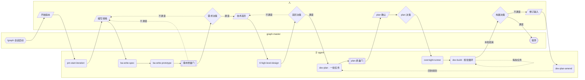

# Plan：agents-workflow-engine

> 日期：2026-11-18
> 状态：**已完成**（图已确认；三期在本 plan 内做完）
> 方向：新模块 + 五个 skill 模板。确认人授权连续实现，不满意再开下一份 plan 调整。

主会话 `graph-master` 从版本启动调度到提测。图按三道横向泳道画：人、graph-master、子 agent。人只在输入和决策处动手。skill 全部由子 agent 执行，主会话不直接调用 skill。子 agent 可以绑定不同模型，用来做对抗验证。`dev-plan` 是批量节点，产出一批任务；`dev-build` 按这一批逐条循环。六步写在 `dev-build` 节点里面，不另立节点。同一泳道里前后相连的节点竖排。开发自测通过即到达终点「提测」。QA 仍是以后的扩展，要先有流水线环境，本版不连、不渲染。图是数据，项目可以改自己的图。预览页用 JointJS，见 [graph.html](../../agents-workflow-engine/graph.html)。

本 plan 覆盖第 1、2、3 期，不拆开做。默认：回路上限 `N` / `n` 为 3；plan 质量门和 plan 决策的「不满意」仍不补边（草图没画）。

## 图

外形：圆角矩形 = 动作，双线矩形 = 门禁，菱形 = 人类决策，平行四边形 = 人类输入。虚线是打回。`N` / `n` 是可重复上限，`1` 是只跑一次。

拼写按仓库 skill 名校正：`tl-high-level-design`、`qa-write-cases`。

三道横向泳道，时间从左到右。批量只标在节点上：`dev-plan` 是一批任务，`dev-build` 按该批循环。预览：`iteration-to-test.html`。

一张同结构的简图：



`dev-build` 框内只作说明，不是图节点：后端 TDD、前端 TDD、构建/Lint、前端 UI review、API 测试、浏览器自测。浏览器自测是本版的结束条件。

第三张子图 QA 先只登记、不渲染、不连边。接入条件是流水线环境就绪。预留节点：`/qa-write-cases`、创建 MR / 流水线部署、E2E 测试、人工补测。

## 读图后锁定的语义

| 种类 | 谁来做 | 运行时行为 |
|---|---|---|
| 动作 | 子 agent | 主会话派一个子 agent 调 skill，写出文件。`sealed: true` 的动作禁止被拆成子节点 |
| 门禁 | 子 agent | 另一个子 agent 调 review skill，只接受「满意 / 不满意」 |
| 人类决策 | 人 | 图停住，人在「满意 / 不满意」里选一条出边。不写业务文档 |
| 人类输入 | 人 | 图停住，人写完一段内容，再沿唯一出边继续 |
| 入口 / 终点 | graph-master | `/graph` 启动主会话；「提测」是主会话的终点，没有出边 |

泳道只有三道，横向从左到右：`human`（人）、`master`（graph-master 主会话）、`subagent`（子 agent）。不按 BA / TL / DEV / QA 分道。

批量：

| 节点 | 是不是批量 | 含义 |
|---|---|---|
| `dev-plan` | 是 | 一批任务。后面的队列和构建都消费这一批 |
| `dev-build` | 按批循环 | 主会话对 `dev-plan` 的每一条任务调用一次这个子 agent。节点本身不拆开 |
| 其余 skill | 否 | `ba-write-spec` 的 `N`、高阶设计的一次，是重试或只跑一次，不是一批任务 |

其他规则：

- 渲染成三道横向泳道。同一 `actor` 上前后相连的节点竖排，用来省横向位置
- `dev-build` 的内层六步画在该节点内部，仍然不是独立节点，预设图不能给这六步加边
- 需求质量门后的人类决策：不满意回到编写规格；满意进入「技术高阶」
- 高阶决策满意后进入 `dev-plan`。终点是「提测」：本批 `dev-build` 结束且构建决策为满意
- QA 放在 `extensions`，`linked: false`。依赖流水线环境，本版不连到提测之后
- 打回计数打在回路上：规格回路上限 `N`，高阶回路上限，开发打回上限 `n`。超限后主会话停住，不再自动打回
- `overnight-runner` 是子 agent 的一个动作，负责排这一批任务的顺序，不取代本引擎

## 子 agent 与对抗验证

主会话只调度。每个 skill 节点启动一个子 agent。子 agent 的模型单独绑定，不默认等于主会话模型。

对抗验证用不同模型：写的人和查的人不是同一个模型。

| 产出 | 核对 | 要求 |
|---|---|---|
| `ba-write-spec` | `ba-requirement-review` | 两个子 agent 的 `model` 不同 |
| `dev-plan` | `dev-plan-review` | 两个子 agent 的 `model` 不同 |
| `dev-build` 实现 | skill 内部的自测 / 评审 | 核对模型与实现模型不同。核对仍封在 `dev-build` 里，图上不另加节点 |

未配置 `model` 时沿用主会话模型，并记一条「未做对抗验证」。配置相同模型时同样记一条，不假装已经对抗过。模型名不写进仓库，用环境变量引用，例如 `{ env: MODEL_WRITER }` 与 `{ env: MODEL_REVIEWER }`。

第 1 期保存 `model` 字段并在相同时提示。第 2 期按该字段拉起子 agent。两期都在本 plan 内完成。

## 确认记录

图已确认，三期一起做。

- 回路上限默认 3
- plan 质量门、plan 决策的「不满意」不补进预设
- 若图还要改，另开一份 plan

## 模块边界

新目录 `agents-workflow-engine/`，与 `overnight-runner/`、`agile-team-sdd/` 并列。

- 不 import 其他模块。skill 名只是字符串
- Python 3.9+，标准库。YAML 子集在本模块里解析，不装 pip 包
- 不改 `dev-build` 内部 LOOP
- 不把 QA 子图接进默认可运行图。接入前要有流水线环境

## DSL

一份图一个 YAML。项目文件是预设加上覆盖，解析结果才是被渲染、被执行的图。

```yaml
id: iteration-to-test
entry: graph-start
lanes:
  - { id: human, title: 人 }
  - { id: master, title: graph-master }
  - { id: subagent, title: 子 agent }
models:
  writer: { env: MODEL_WRITER }
  reviewer: { env: MODEL_REVIEWER }
loops:
  - id: spec
    maxIterations: 3
    backEdges: [req-gate-reject, req-decision-reject]
  - id: hld
    maxIterations: 3
    backEdges: [hld-reject]
  - id: dev
    maxIterations: 3
    backEdges: [build-reject]
nodes:
  - { id: graph-start, actor: master, kind: entry, title: 会话启动 }
  - { id: start-version, actor: human, kind: human_input, title: 开始版本 }
  - { id: pm-start-iteration, actor: subagent, kind: action, skill: pm-start-iteration, title: 开始迭代, model: writer }
  - { id: write-spec, actor: human, kind: human_input, title: 编写规格 }
  - { id: ba-write-spec, actor: subagent, kind: action, skill: ba-write-spec, title: 需求规格, model: writer }
  - { id: ba-write-prototype, actor: subagent, kind: action, skill: ba-write-prototype, title: 原型, once: true, model: writer }
  - { id: ba-requirement-review, actor: subagent, kind: gate, skill: ba-requirement-review, title: 需求质量门, model: reviewer }
  - { id: requirement-decision, actor: human, kind: decision, title: 需求决策, options: [满意, 不满意] }
  - { id: tech-brief, actor: human, kind: human_input, title: 技术高阶 }
  - { id: tl-high-level-design, actor: subagent, kind: action, skill: tl-high-level-design, title: 技术高阶设计, once: true, model: writer }
  - { id: hld-decision, actor: human, kind: decision, title: 高阶决策, options: [满意, 不满意] }
  - { id: dev-plan, actor: subagent, kind: action, skill: dev-plan, title: 详细规划, batch: true, model: writer }
  - { id: dev-plan-review, actor: subagent, kind: gate, skill: dev-plan-review, title: plan 质量门, model: reviewer }
  - { id: plan-confirm, actor: human, kind: human_input, title: plan 确认 }
  - { id: plan-decision, actor: human, kind: decision, title: plan 决策, options: [满意, 不满意] }
  - { id: overnight-runner, actor: subagent, kind: action, skill: overnight-runner, title: 排本批顺序, model: writer }
  - { id: dev-build, actor: subagent, kind: action, skill: dev-build, title: 构建与自测, sealed: true, repeatsBatch: dev-plan, model: writer,
      note: [后端 TDD, 前端 TDD, 构建/Lint, 前端 UI review, API 测试, 浏览器自测] }
  - { id: build-decision, actor: human, kind: decision, title: 构建决策, options: [满意, 不满意] }
  - { id: amend-input, actor: human, kind: human_input, title: 修订输入 }
  - { id: dev-plan-amend, actor: subagent, kind: action, skill: dev-plan-amend, title: 规划修订, model: writer }
  - { id: handoff, actor: master, kind: end, title: 提测 }
extensions:
  - id: qa
    title: 测试
    linked: false
    requires: pipeline
    nodes:
      - { id: qa-write-cases, kind: action, title: QA 用例 }
      - { id: dev-create-mr, kind: action, title: 创建 MR/流水线部署 }
      - { id: qa-run-e2e, kind: action, title: E2E 测试 }
      - { id: manual-test, kind: human_input, title: 人工补测 }
edges:
  - { id: e0, from: graph-start, to: start-version }
  - { id: e1, from: start-version, to: pm-start-iteration }
  - { id: e2, from: pm-start-iteration, to: write-spec }
  - { id: e3, from: write-spec, to: ba-write-spec }
  - { id: e4, from: ba-write-spec, to: ba-write-prototype }
  - { id: e5, from: ba-write-spec, to: ba-requirement-review }
  - { id: e6, from: ba-write-prototype, to: ba-requirement-review }
  - { id: req-pass, from: ba-requirement-review, to: requirement-decision, when: 满意 }
  - { id: req-gate-reject, from: ba-requirement-review, to: write-spec, when: 不满意, back: true }
  - { id: req-decision-reject, from: requirement-decision, to: write-spec, when: 不满意, back: true }
  - { id: e7, from: tech-brief, to: tl-high-level-design }
  - { id: e8, from: tl-high-level-design, to: hld-decision }
  - { id: req-ok, from: requirement-decision, to: tech-brief, when: 满意 }
  - { id: hld-reject, from: hld-decision, to: tech-brief, when: 不满意, back: true }
  - { id: hld-ok, from: hld-decision, to: dev-plan, when: 满意 }
  - { id: e9, from: dev-plan, to: dev-plan-review }
  - { id: plan-pass, from: dev-plan-review, to: plan-confirm, when: 满意 }
  - { id: e10, from: plan-confirm, to: plan-decision }
  - { id: plan-ok, from: plan-decision, to: overnight-runner, when: 满意 }
  - { id: e11, from: overnight-runner, to: dev-build }
  - { id: e12, from: dev-build, to: build-decision }
  - { id: build-pass, from: build-decision, to: handoff, when: 满意 }
  - { id: build-reject, from: build-decision, to: amend-input, when: 不满意, back: true }
  - { id: e13, from: amend-input, to: dev-plan-amend }
  - { id: e14, from: dev-plan-amend, to: dev-plan, back: true }
```

技术高阶的正向入口是需求决策的「满意」。打回仍回到技术高阶。

校验至少拒绝：

- 工作节点 `kind` 不在四种之内。另允许各一个 `entry`（会话启动）和一个无出边的 `end`（提测）
- `actor` 不在 `human` / `master` / `subagent` 之内。skill 节点的 `actor` 必须是 `subagent`
- `batch: true` 的节点没有被某个 `repeatsBatch` 消费
- 配对的产出节点与门禁节点 `model` 相同（记「未做对抗验证」，不阻断渲染）
- 边指向不存在的节点，或指向 `sealed` 节点的 `note` 项，或指向 `extensions` 里的节点
- 决策节点的 `when` 不在 `options` 里
- 门禁、决策的 `when` 不在「满意 / 不满意」里；草图没画的出边不补进预设
- `linked: false` 的扩展子图出现在默认可运行边里
- 人类输入多于一条出边
- 打回边没有 `loops.maxIterations`
- 覆盖文件删掉 `dev-build.sealed`，或往 `note` 里的步骤加边

## 项目怎么改自己的图

目标项目可选文件：`.agents/workflow/overlay.yaml`。引擎读套件预设，再叠覆盖。

允许的操作：`disable` 节点、替换动作的 `skill`、`insert` 节点和边、改门禁的 `when` 目标、改某条打回边和所属 loop 的 `maxIterations`。

```yaml
disable: [ba-write-prototype]
replace:
  ba-write-spec: { skill: my-write-spec }
loops:
  - { id: spec, maxIterations: 2 }
```

`disable` 会删掉该节点及其边；若因此断成两条无法汇合的轨道，`validate` 报错并指出节点 id。

## 渲染

`render` 只读解析后的图，写出 Mermaid。映射固定：

| kind | Mermaid |
|---|---|
| action | `id(标题)` |
| gate | `id[[标题]]` |
| decision | `id{标题}` |
| human_input | `id[/标题/]` |
| back 边 | `-.->` 并标 `when` |
| sealed | 单节点，`note` 写进标签，不展开成节点 |
| end | `([提测])`，无出边 |
| 整图 | 三道横向泳道。同一泳道内连续节点竖排。`dev-build` 的六步画在节点内 |
| extensions | `linked: false` 时不输出 |

不引入 BPMN、Camunda、React Flow，也不做可视化编辑器。

## 分期

三期都在本 plan 内完成。

### 第 1 期

- 包 `agents_workflow_engine`：`cli` / `yaml_lite` / `load` / `merge` / `validate` / `render_mermaid`
- `schema/graph.schema.json` 与 `presets/iteration-to-test.yaml`
- 子命令：`validate`、`resolve`、`render`。都有 `--help`。`render --dry-run` 只打印
- 单测：合并、封死节点、扩展不能连边、回路缺上限、Mermaid 外形、模型相同只警告
- `./.agents/verify.sh` 增加本模块单测
- 根 `README.md` 模块表加一行；`AGENTS.md` 补拓扑和模块职责
- `scripts/install.sh <目标> [--dry-run] [--force]` 把预设拷到目标 `.agents/workflow/preset.yaml`，不覆盖已有 `overlay.yaml`

### 第 2 期

- `run`：主会话按图派子 agent。子 agent 读取节点上的 `model`
- 产出 skill 与门禁 skill 的模型不同才算对抗验证；相同则记入 `.agents/workflow/decisions.jsonl`
- `dev-plan` 的一批任务由主会话记下，之后对每一条调用一次 `dev-build`
- 人类输入、人类决策从 `--answers` 读取；缺答案时退出并写明要补哪一项
- 回路超限后停住，不再沿打回边走

### 第 3 期

补五个 skill 模板并装进 example：`pm-start-iteration`、`ba-write-prototype`、`ba-requirement-review`、`dev-plan-review`、`dev-plan-amend`。同步 `catalog.json`、套件表格、根 README。

## 非目标

- 不改 `overnight-runner` 的队列、面板和决策窗口
- 不把 BA / TL / DEV / QA 做成泳道。泳道只有人、主会话、子 agent
- 不编辑 `dev-build` 内部六步
- 不把 QA 子图接进默认可运行路径。流水线环境就绪后再扩展

## 验证

三期：

```bash
PYTHONPATH=agents-workflow-engine python -m agents_workflow_engine validate
PYTHONPATH=agents-workflow-engine python -m agents_workflow_engine render --dry-run
PYTHONPATH=agents-workflow-engine python agents-workflow-engine/tests/test_units.py
./agents-workflow-engine/scripts/install.sh example-project --dry-run
PATH_MODE=relative ./agile-team-sdd/install.sh example-project --force
./.agents/verify.sh
```

## 文档同步检查

实现时更新：根 `README.md` 模块表与技能数量、`AGENTS.md` §1 / §3 / §8、本模块 `README.md`、`agile-team-sdd` 的 catalog 与表格。`team-workflow-guide` 不在本轮改。
