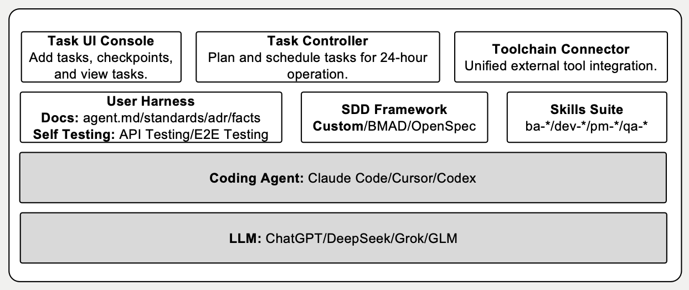

# team-harness-suite

> **团队级 AI 基础设施。**
> 把散落在个人电脑上的 AI 编程经验，收敛成一套 **可安装、可交接、可复制** 的团队工具链。

AI4SE 框架构想（框内元素仅为示例，可能会装入更多实践）:



## 为什么做这个

一个团队用 AI 编程，真正的瓶颈不是模型，而是 **定制适合自己的 Harness 套件**：

- 每个人的 prompt、skill、调试手法都不一样，能力无法高效衔接
- 换个人接手，所有上下文归零
- 工具（MCP、脚本、环境）全在个人机器上，别人跑不起来
- 流程靠口头约定，跳步、少测、文档不同步的问题反复出现

这个仓库把这些东西 **固化成资产**，让所有 skill 和 harness 都能容易调整和修改，有机的整合到一起：

| 原来 | 现在 |
|---|---|
| 个人 skill | `agile-team-sdd/` 里的模板 + 一键安装 |
| 一份口头流程 | `team-workflow-guide/` 里的角色手册与流程定义 |
| 各人机器上的 MCP | `tool-chain-installer/` 统一安装到项目配置 |
| 每个人手搓的目录结构 | `harness-installer/` 一键铺好 `AGENTS.md` + `docs/` |
| 没有参照实现 | `example-project/` 一份完整可跑的例子 |

## 模块

| 模块               | 目录                                                                                   | 目的                                                                                            | 形态                |
| ---------------- | ------------------------------------------------------------------------------------ | --------------------------------------------------------------------------------------------- | ----------------- |
| **SDD 技能套件**     | [`agile-team-sdd/`](agile-team-sdd/)                                                 | 团队统一的开发流程 skill，26 个覆盖 BA→TL→PM→开发→QA→发布→复盘，含无前缀的 `overnight-runner`。模板带占位符，可安装到任意项目，并容易被调整修改 | skill + 安装脚本      |
| **Harness 初始化器** | [`harness-installer/`](harness-installer/)                                           | 为任意项目铺好工程底座：`AGENTS.md` + `docs/`（含 `architecture/` 高阶意图骨架、features / facts / standards） | skill + 模板 + 脚本   |
| **工具链安装器**       | [`tool-chain-installer/`](tool-chain-installer/)                                     | 把 MCP 工具链（chrome-devtools、playwright、context7…）写进项目配置，不依赖个人机器的全局状态                            | skill + 工具清单 + 脚本 |
| **团队工作流指南**      | [`团队工作流指南`](https://inspirechina.github.io/ai4se-harness-suite/team-workflow-guide/) | 团队级协作手册（HTML 单页）：总览矩阵 + 项目准备 → 迭代前设计 → 迭代中开发；角色、测试归属、闸门                                       | 文档                |
| **持续运行面板** | [`overnight-runner/`](overnight-runner/) | 把一串 plan 交给 coding agent 跑：左边任务队列、右边 agent 实时输出，看门狗自动重试，多队列各自独立，决策全程留痕 | skill + Python 实现 |
| **工作流引擎** | [`agents-workflow-engine/`](agents-workflow-engine/) | 主会话按泳道图调度子 agent，从版本启动到 E2E 测试通过。子 agent 可绑不同模型做对抗验证 | Python 实现 |
| **参考实现**         | [`example-project/`](example-project/)                                               | 一份完整、可跑、已填满规范的全栈参考项目（Vue 3 + Spring Boot + DDD 四层），用来对照与教学                                    | 示例项目              |

## 关系图

```
                      team-workflow-guide/
                   （流程与角色约定 · 人看）
                                │
        ┌───────────────────────┼───────────────────────┐
        │                       │                       │
 harness-installer       agile-team-sdd       tool-chain-installer
  AGENTS.md 规范          26 个 SDD skill        MCP 工具链
  docs/ 含 architecture   BA·TL·Dev·QA·PM 全流程
        │                       │                       │
        └───────────────────────┼───────────────────────┘
                                │
                                ▼
                        example-project/
                     （参考实现 · 已装好全套）
```

## SDD 技能套件（26 个）

| 组 | Skill | 作用 |
|---|---|---|
| **BA** | `ba-grill-me` | 拷问需求，把模糊描述逼成可验收的规格 |
| | `ba-write-spec` | 编写需求规格；维护项目级术语表（`docs/architecture/business/glossary.md`） |
| | `ba-write-prototype` | 按 spec 做原型，放到该迭代 prototypes |
| | `ba-requirement-review` | 用另一个模型审查 spec，只回答满意或不满意 |
| | `ba-gen-facts` | 从代码生成/校准事实文档：API、库表、领域模型、专题 |
| | `ba-arch-sync-back` | 业务侧对齐：术语 / 核心领域 / 产品 ↔ features 与 facts |
| **TL** | `tl-arch-plan` | 项目准备写/更新 `docs/architecture/`（C4、ADR 一句话表、与业务侧） |
| | `tl-arch-sync-back` | 技术侧对齐：ADR/C4 ↔ 实现与 facts 专题 |
| | `tl-high-level-design` | 写迭代高阶技术设计（HLD / TRD），确认前不得开 Plan |
| **Dev** | `dev-plan` | 写技术方案（含 DST 自测 + 界面对照基线），等待确认 |
| | `dev-plan-review` | 用另一个模型审查 plan，只回答满意或不满意 |
| | `dev-plan-amend` | 按人的修订意见改 plan |
| | `dev-build` | 全栈 LOOP：实现 + 自测/UI 落盘修到绿 + 代码评审 |
| | `dev-self-test` | 真实本地环境按 DST 自测并落盘 |
| | `dev-code-review` | 代码评审（由 build LOOP 调用，可单跑） |
| | `dev-ui-review` | 原型对照字段/控件与截图并落盘 |
| | `dev-release-plan` | 整理迭代上线准备清单 |
| | `dev-create-mr` | 创建 Merge Request / Pull Request |
| **QA** | `qa-write-cases` | 编写 QA 用例（`TC-xxx` 文本 + 自动化） |
| | `qa-run-e2e` | 运行 E2E 用例集并定位失败 |
| | `qa-write-manual-plan` | 编写手动测试与冒烟用例计划 |
| **PM** | `pm-estimate` | 基于需求分类基线表估算工作量 |
| | `pm-start-iteration` | 按版本名建立迭代目录 |
| | `pm-retro` | 复盘并把改进项回写到 harness 本身 |
| **Runner** | `overnight-runner` | 队列跑已确认 plan（无角色前缀） |

流程串起来：

```
项目准备：tl-arch-plan（BA/TL）→ docs/architecture/
ba-grill-me → ba-write-spec → pm-estimate
                    ↓
        ┌───────────┴───────────┐
 tl-high-level-design     qa-write-cases   ← 规格确认后并行
   （HLD 人工确认）
        └───────────┬───────────┘
                    ↓
              dev-plan（人工确认）→ dev-build
                    │  LOOP self-test → ui-review → code-review
                    ↓
     ba-gen-facts / arch sync-back / dev-create-mr
                    ↓
      qa-run-e2e / qa-write-manual-plan   ← 合并闸门
                    ↓
            dev-release-plan → pm-retro → 改进 harness
```

## 实践索引

| 实践 | 说明 | 看哪里 |
|---|---|---|
| 团队级 SDD 框架 | 适合团队协作和拓展修改的 SDD 框架；纯 skill 驱动，与具体 agent 无关 | [`agile-team-sdd/`](agile-team-sdd/) |
| 夜间任务 | 把一串 plan 交给 coding agent 无人值守跑：多队列、看门狗重试、决策全程留痕（白天可弹窗、夜里自动兜底） | skill [`overnight-runner`](agile-team-sdd/skills/overnight-runner-template/SKILL.md) · 运行时 [`overnight-runner/`](overnight-runner/) |
| 团队流程手册 | 人怎么配合：总览矩阵、项目准备（含架构设计）→ 迭代前 → 迭代中；角色、测试归属与闸门 | [`team-workflow-guide/`](team-workflow-guide/index.html) |
| Agent as Code | 所有 Harness（skills、AGENTS、docs 骨架、MCP、overnight-runner）可安装进代码仓库，换机器 clone 即可用 | [`harness-installer/`](harness-installer/) · [`tool-chain-installer/`](tool-chain-installer/) |
| 文档三分法 | `architecture/` 高阶意图 · `features/` 过程 · `facts/` as-built | [architecture](example-project/docs/architecture/README.md) · [docs 总览](example-project/docs/README.md) |
| 高阶设计 | 项目级 C4 / ADR 一句话表 / 核心领域模型 + 迭代 HLD；确认后再开 feature Plan | [`tl-arch-plan`](agile-team-sdd/skills/tl-arch-plan-template/SKILL.md) · [`tl-high-level-design`](agile-team-sdd/skills/tl-high-level-design-template/SKILL.md) |
| ADR | 跨迭代取舍写成一句话决策表（非长文） | [ADR 规范](example-project/docs/standards/adr.md) · [ADR 表](example-project/docs/architecture/tech/adr.md) |
| 核心领域模型 | architecture 只维护核心聚合 + 关键字段；全量 as-built 在 facts | [core-domain-model](example-project/docs/architecture/business/core-domain-model.md) · [facts domain-model](example-project/docs/facts/domain-model.md) |
| 代码打样 | 迭代内用独立 Vite 原型先把交互与页面打通，规格与验收对齐后再进实现 | [iteration1 原型](example-project/docs/features/iteration1/prototypes/README.md) |
| 事实文档 | 实现后校准 `docs/facts/`（API、库表、全量领域、实现专题） | [`ba-gen-facts`](agile-team-sdd/skills/ba-gen-facts-template/SKILL.md) · [facts](example-project/docs/facts/README.md) |
| 全栈端到端 Loop 开发 | Plan（含 DST）确认后 `dev-build`：实现 → 真实环境自测落盘 → 原型 UI 对照落盘 → 代码评审，以记录修到绿 | [`dev-build`](agile-team-sdd/skills/dev-build-template/SKILL.md) · [流程指南](team-workflow-guide/index.html) |
| 团队上下文共享 | BA / DEV / QA 等角色的产出物（规格、Plan、用例、事实文档、架构）都进代码仓库，换人 clone 即可接上 | [`example-project/docs/`](example-project/docs/README.md) · [Agent as Code](harness-installer/) |
| Mono repo | 统一仓库承载前后端、文档与 harness；客观条件限制时可用 submodule 拼出等价布局 | [`example-project/`](example-project/)（containers + docs + skills 同仓） |

## 快速开始

### 体验现成的

```bash
cd example-project
cat AGENTS.md          # 一份填满的工程规范范本
ls .agents/skills/      # 已安装的 26 个 SDD skills
```

### 装到自己的新项目

```bash
# 1. 铺 harness：生成 AGENTS.md + docs/ 骨架
./harness-installer/scripts/init-harness.sh ../my-project

# 2. 装 SDD skills（渲染占位符 → 写进 .agents/skills/）
./agile-team-sdd/install.sh ../my-project

#    也可以只装某一组 / 某几个
./agile-team-sdd/install.sh ../my-project --group qa
./agile-team-sdd/install.sh ../my-project --skill dev-plan --skill pm-retro

# 3. 装 MCP 工具链
node tool-chain-installer/scripts/install-tools.mjs ../my-project --group browser --group context

# 4. 项目准备：填 docs/architecture/（C4、ADR、术语/产品/核心领域、迭代规划）
#    对 Agent 说：用 tl-arch-plan（BA 协作）写高阶架构
```

第 1 步之后，**必须有人补全** `AGENTS.md` **里的** `TODO` **段落** —— 规范不填满，装出来的只是空壳。  
进迭代前，`docs/architecture/` 应可读（可与装机并行，但 HLD / Plan 之前须齐）。

## 设计原则

| 原则 | 含义 |
|---|---|
| **模板 + 安装，而非拷贝** | 同一套能力能装到不同技术栈的项目；占位符保证路径真实可用 |
| **配置进仓库，不进个人机器** | MCP、skills、脚本都写进项目配置，换机器 clone 就能跑 |
| **规范是事实，不靠口头** | `AGENTS.md` / `docs/standards/` 是唯一权威，冲突以文件为准 |
| **意图 / 过程 / as-built 分开** | `architecture/` 写目标，`features/` 写本迭过程，`facts/` 跟代码 |
| **AI 执行，人决策** | 迭代 HLD 与 feature Plan 两道人工确认闸门；范围、需求、规范变更必须人拍板 |
| **幂等可重入** | 所有安装脚本可重复执行，默认不覆盖已有文件 |

## 目录结构

```
team-harness-suite/
├── AGENTS.md             # 本仓库的架构与工程规范（改代码前先读）
├── agile-team-sdd/       # SDD 技能套件（26 个模板 + catalog.json + 安装脚本）
├── harness-installer/    # AGENTS.md / docs 骨架初始化
├── tool-chain-installer/ # MCP 工具链安装
├── team-workflow-guide/  # 团队流程与角色手册
├── overnight-runner/     # 无人值守跑 plan 的分屏面板 + 看门狗
├── example-project/      # 全栈参考实现（已装全套 skills）
├── .agents/
│   ├── verify.sh         # 一键验证
│   ├── plan/             # 本仓库开发计划
│   └── skills/           # 维护型：work-in-example / modify-example / modify-harness
└── opencode.jsonc        # 注册本仓库的 skills 路径
```

## 开发

```bash
./.agents/verify.sh          # 全量验证
./.agents/verify.sh --fast   # 跳过冒烟测试
```

工程约定见 [`AGENTS.md`](AGENTS.md) —— 改任何脚本前先读它。

## 状态

| 模块 | 状态 |
|---|---|
| `agile-team-sdd/` | ✅ 可用（26 个 skill） |
| `harness-installer/` | ✅ 可用（`AGENTS.md` 模板含 TODO，需人工补全） |
| `tool-chain-installer/` | ✅ 可用 |
| `team-workflow-guide/` | ✅ 可用 |
| `overnight-runner/` | ✅ 可用（面板 / 看门狗 / 多队列 / 决策记录 / 决策窗口） |
| `example-project/` | ✅ 完整可跑 |

## TODO

- 任务协调器（L4）
- OpenWiki
- ArchUnit
- CodeGraph

## License

见 [LICENSE](LICENSE)。
# poc-company-a
