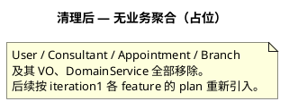
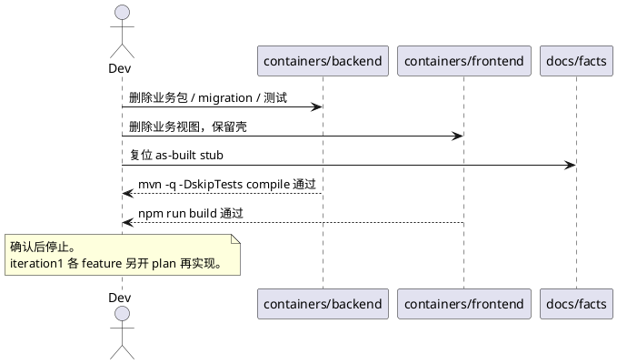

# 清理示例实现，为 iteration1 新需求落地腾空

>日期： 2026-11-17
>
>关联需求：docs/features/iteration1/（ACC～PLT 共 9 份 spec；本 chores 不实现业务）
>
>关联原型：docs/features/iteration1/prototypes/
>
>**plan一旦定稿就不修改。** 同一横切二次改造新建 `plan-{slug}.md`，不修改本文件。

> 状态：**已确认执行**（2026-11-17）— 按 §1.3 拍板清理。


## 1. 文档说明

### 1.1 背景

- **目标需求**：`docs/features/iteration1/`（ACC～PLT 共 9 份 spec + 独立 prototypes）。
- **现状问题**：仓库里另有一套更早的「咨询预约」示例实现与配套 as-built 文档/用例，与 iteration1 **不对齐**，会干扰后续按规格实现。
- **产品意图（2026-11-17）**：iteration1 是要实现的目标；**之前的代码和文档都清掉**。

### 1.2 目标

- **实现目标**：
  1. **删代码**：示例业务实现（后端四聚合与全层、前端业务页、测试、Flyway、E2E 旧断言）。
  2. **删/复位文档**：凡描述「旧示例已实现状态」的文档一律清理（facts、旧 test-cases、旧 demo 相关 chores plan）；不留误导性 as-built。
  3. **保留**：`docs/features/iteration1/`（含 prototypes）、`docs/standards/`、`docs/features/_template/`、`AGENTS.md`、`.agents/skills/`、可编译空壳 `containers/` + 平台横切骨架。
  4. 清理后工程 =「空壳 + iteration1 需求输入」，再按 AGENTS.md §14 为各 feature 开 plan 实现。
- **技术边界**：
  - 本 plan **只做清理与骨架复位**，不实现任何 iteration1 业务功能。
  - 不改父仓 harness 套件源码；仅动 `example-project/`。
  - **不改** `docs/features/iteration1/prototypes/` 的演示行为（可继续 `npm run dev`）。

### 1.3 关键决策（已按意图收敛，请最终确认）

| # | 决策点 | 拍板 |
|---|---|---|
| D1 | 包名 `com.consultation` | **保留** |
| D2 | JWT / Security / UserContext 骨架 | **保留**空壳（无登录业务 API） |
| D3 | BusinessRule / DataDictionary 框架代码 | **保留**空注册；示例规则/字典枚举与 YAML **删除** |
| D4 | 旧 Flyway | **直接删除**脚本；不写 drop migration |
| D5 | iteration1 specs / prototypes / iteration1 README | **全部保留**（目标需求） |
| D6 | 「之前的文档」 | **清理**（见下表），不是只 stub 一句 |

**D6 文档去留明细**

| 路径 | 动作 |
|---|---|
| `docs/features/iteration1/**` | **保留** |
| `docs/standards/**`、`docs/features/_template/**` | **保留**（工程规范，非旧业务 as-built） |
| `docs/features/_chores/plan-20261116-iteration1-*.md` | **保留**（服务 iteration1 骨架/原型的历史 plan） |
| `docs/features/_chores/plan-20261117-purge-demo-impl-for-iteration1.md` | **保留**（本 plan） |
| `docs/features/_chores/plan-20260619-project-plan.md` | **删除**（旧示例总计划） |
| `docs/features/_chores/plan-20261106-*.md` | **删除**（旧示例修补 plan） |
| `docs/facts/api.yaml`、`db-schema.md`、`domain-model.md` | **删内容并改成空壳 stub**（标明尚未实现） |
| `docs/facts/business/booking-flow.md` | **删除** |
| `docs/facts/tech-topic/businessrule.md`、`data-dict.md`、`state-machine.md` | **删内容改 stub** 或删除文件（与空壳一致） |
| `docs/facts/tech-topic/001～005`、`error-code.md`、`security.md` | **保留框架向说明**（仍约束空壳：分层/UUID/JWT/ThreadLocal/错误模型）；去掉「已实现某业务 API」的表述 |
| `docs/test-cases/e2e-cases|manual-cases|smoking-cases/**` | **清空为目录 + 短 stub**（无旧 TC-xxx） |
| `docs/test-cases/README.md`、`dev-self-cases/README.md` | **保留并改写**为指向「用例待按 iteration1 编写」 |
| 根 `README.md` | **改写**为空壳说明 + 指向 iteration1 |

以下正文按上表执行；若最终确认有偏差，先改口再动手。

---

## 2. 领域模型（PlantUML）

本次无新增领域实体。清理后 domain 层为空（或仅保留与平台骨架相关的空包）。



---

## 3. 数据库设计（SQL DDL）

清理后 **无业务表**。删除现有 migration：

- `containers/backend/src/main/resources/db/migration/V20260619__init_user.sql`
- `containers/backend/src/main/resources/db/migration/V20260620__consultant_appointment.sql`
- `containers/backend/src/main/resources/db/migration/V20260621__branch.sql`

测试用 `schema.sql` / `data.sql` 同步清空为最小可启动（可仅保留空文件或注释说明）。

后续 iteration1 实现时再新增 Flyway（建议新序列，如 `V20261117__...` 起），并同步 `docs/facts/db-schema.md`。

```sql
-- 清理后无业务 DDL。占位：工程可启动，Flyway 无待执行脚本即可。
```

---

## 4. API 设计（OpenAPI）

清理后对外仅保留（可选）健康/首页探针；业务 API 全部移除。

```yaml
openapi: 3.0.0
info:
  title: Consultation Platform API (skeleton)
  version: 0.0.0
paths:
  /api/v1/health:
    get:
      summary: 存活探针（骨架）
      responses:
        '200':
          description: OK
          content:
            application/json:
              schema:
                type: object
                properties:
                  status:
                    type: string
                    example: UP
```

原 Auth / User / Consultant / Appointment / Admin / BusinessRule / DataDictionary 业务路径从 `docs/facts/api.yaml` 移除或文件复位为上述骨架。

---

## 5. 时序图（PlantUML）



---

## 6. 专题设计（Markdown）

### 6.1 权限设计

* 保留 JWT 相关类与 `SecurityConfig` 骨架；清理后默认策略：**除 `/api/v1/health`（及静态/前端代理）外，其它 `/api/**` 需认证或直接 401**（实现时取「仅放行 health」最简配置，避免空壳被误用）。
* 删除依赖 User 仓储的登录/注册过滤器业务路径；无 token 签发入口直至 ACC plan 落地。

### 6.2 并发控制

* 不适用（无写路径）。

### 6.3 事务设计

* 保留「事务在 application 层」规范；清空后无 `@Transactional` 业务方法。

### 6.4 异常处理

* **保留** `GlobalExceptionHandler` 与现有错误码约定（见 `docs/standards/error.md` / `docs/facts/tech-topic/error-code.md` 中与框架相关的部分）。

### 6.5 性能设计

* 不适用。

### 6.6 扩展性设计

* 包结构与分层目录保留空包或 README 占位，便于按 `docs/standards/templates/` 再生成。

---

## 7. 一致性约束（必须遵守）

* 清理后：`docs/facts/` 不得再描述已删除的表/API/聚合。
* `docs/features/iteration1/**` 规格与原型 **不得** 因本次清理被改写业务规则（仅允许在 README 中加一句「业务实现已复位，待按 feature plan 重建」类说明，可选）。
* 命名与分层规范仍以 `AGENTS.md` / `docs/standards/` 为准。
* 不引入与清理无关的依赖升级。

---

## 8. 单元测试设计

### 8.1 测试范围

* 删除全部示例相关单元/领域测试。
* 骨架阶段可不新增单元测试；若保留 `GlobalExceptionHandler`，可选留 1 个轻量测试（非必须）。

### 8.2～8.4

* 策略沿用项目规范；本 chores 以删除为主。

### 8.5 用例清单

| 被测单元 | 场景类型 | 用例说明 | 预期结果 | 关联章节 |
| :------: | :------: | :------: | :------: | :------: |
| （清理） | — | 删除旧 `*Test` 中业务用例 | 无编译引用残留 | §11 |
| Health（可选） | 正常 | 探针返回 UP | 200 | §4 |

---

## 9. API 集成测试设计

### 9.1 测试范围

* 删除现有 RestAssured 业务集成测试（Auth/Appointment/Admin 等）。
* 可选保留：`should_return_up_when_get_health` 一条，证明空壳可起。

### 9.2 测试环境

* 仍用 MariaDB4j + `@ActiveProfiles("test")`；`schema.sql`/`data.sql` 置空或最小。
* Flyway test 继续 `enabled=false`（与现约定一致）。

### 9.5 用例清单

| 接口 | 场景类型 | 用例说明 | 预期结果 | 关联章节 |
| :--: | :------: | :------: | :------: | :------: |
| `GET /api/v1/health` | Happy | 空壳启动后可访问 | 200 + status=UP | §4 |

---

## 10. E2E 测试设计

### 10.1 测试范围

* `e2e/tests/qa/app.spec.ts`、`e2e/tests/dev/visual.spec.ts`：改为仅断言前端壳首页可打开（或暂时 `test.skip` 并在 README 注明待 iteration1 重建）。
* `docs/test-cases/e2e-cases/test-cases.md` 等：清空旧 TC 正文，保留目录与「用例归属」说明，或改为 stub「暂无 QA 用例，待 feature 编写」。

### 10.6 用例清单

| 链路名称 | 覆盖步骤 | 验证点 | 关联章节 |
| :------: | :------: | :----: | :------: |
| 壳冒烟（dev） | 打开 `/` | 标题/入口存在 | §11 |

---

## 11. 修改清单

### 11.1 代码修改

#### 11.1.3 删除 — 后端业务

删除（含测试对称文件，路径以仓库实存为准）：

**adapter**

- `containers/backend/src/main/java/com/consultation/adapter/rest/AdminController.java`
- `.../AppointmentController.java`
- `.../AuthController.java`
- `.../ConsultantController.java`
- `.../UserController.java`
- `.../BusinessRuleController.java`（若 D3 选保留框架则改为空列表实现，否则删除）
- `.../DataDictionaryController.java`（同上）
- `.../HomeController.java`（若与业务耦合则删；健康探针改独立 `HealthController`）
- `adapter/rest/dto/**` 业务 DTO

**application**

- `application/service/*`（Admin/Appointment/Auth/Consultant/User 及 BusinessRule/DataDictionary 若无空壳价值则删）
- `application/assembler/**`

**domain**

- `domain/aggregate/{User,Consultant,Appointment,Branch}.java`
- `domain/vo/**` 业务枚举
- `domain/repository/**`
- `domain/service/**` 业务域服务
- `domain/businessrule` / `domain/datadictionary`：按 D3 — 建议保留接口与空注册，删除 Appointment/Auth 等示例规则枚举与 YAML 业务条目

**infrastructure**

- `repositoryimpl/**`
- `persistence/po/**`、`mapper/**`、`converter/**` 业务文件
- 保留：`GlobalExceptionHandler`、`SecurityConfig`（改配置）、`Jwt*`、`UserContext*`、`JacksonConfig`、`WebConfig`、`MybatisPlusConfig`
- 删除：`PasswordServiceImpl` 若仅服务已删 Auth；或留接口空实现待 ACC

**resources**

- 删除上述 3 个 Flyway 业务脚本
- `resources/business-rules/**` 示例规则 YAML：清空或删
- test `schema.sql` / `data.sql` / `ResetDbService` 业务表逻辑：改空

**测试**

- `containers/backend/src/test/java/**` 中业务 `*Test.java` 全部删除

#### 11.1.2 新增 — 后端骨架

- `adapter/rest/HealthController.java` — `GET /api/v1/health`
- （可选）各层空包保持 `package-info.java` 或目录存在即可
- 最小集成测试 `HealthControllerTest`（可选）

#### 11.1.3 删除 — 前端业务

- `containers/frontend/src/views/admin/**`
- `containers/frontend/src/views/user/**`（业务页）
- `containers/frontend/src/views/auth/**`（登录注册；ACC 再做）
- 业务 API `src/api/**`、业务 composables、业务类型字段

#### 11.1.1 修改 — 前端壳

- `router/index.ts` — 仅 `/` 首页
- `views/home/HomePage.vue` — 改为「工程骨架 / 指向 iteration1 原型与规格」的占位页（可链到规格路径说明，勿依赖后端业务）
- `stores/auth.ts` — 清空为最小 store 或删除并去掉引用
- `components/layout/*` — 收拢为单一简单布局或极简 header

#### 11.1.3 删除/修改 — E2E 与用例文本

- 重写或瘦身：`e2e/tests/qa/app.spec.ts`、`e2e/tests/dev/visual.spec.ts`
- stub：`docs/test-cases/e2e-cases/test-cases.md`、`manual-cases/`、`smoking-cases/` 中旧 TC

#### 11.1.x 关键文件速查

| 操作 | 文件 / 目录 | 备注 |
| :--: | :-- | :-- |
| 删除 | `containers/backend/.../domain/aggregate/*` | 四聚合 |
| 删除 | `containers/backend/.../adapter/rest/*Controller`（业务） | 见上 |
| 删除 | `containers/backend/.../db/migration/V20260619*.sql` 等三份 | Flyway |
| 删除 | `containers/frontend/src/views/{admin,user,auth}/**` | 业务 UI |
| 新增 | `.../HealthController.java` | 探针 |
| 修改 | `SecurityConfig.java` | 仅放行 health |
| 修改 | `containers/frontend/src/router/index.ts` | 仅首页 |
| 复位 | `docs/facts/api.yaml` | 骨架 OpenAPI |
| 复位 | `docs/facts/db-schema.md` | 无表说明 |
| 复位 | `docs/facts/domain-model.md` | 无聚合说明 |
| 修订 | `docs/facts/tech-topic/businessrule.md`、`data-dict.md`、`state-machine.md` 等 | 去掉示例业务内容或标「待重建」 |
| 修订 | `README.md` | 说明当前为空壳，需求见 iteration1 |
| 保留 | `docs/features/iteration1/**` | 含 prototypes |
| 保留 | `docs/standards/**`、`AGENTS.md`、`.agents/**` | harness |

### 11.2 接口变更

| 路径 | 方法 | 变更类型 | 说明 |
| :--: | :--: | :--: | :-- |
| `/api/v1/health` | GET | 新增 | 骨架探针 |
| `/api/v1/**` 原业务 | * | 删除 | Auth/预约/管理等全部下线 |
| `/admin/**` | * | 删除 | 管理端 API 下线 |

### 11.3 数据库变更

- 删除既有 Flyway 业务脚本（非新增 V__drop）。
- 影响表：`user` / `consultant` / `appointment` / `branch`（及脚本中实际表名）——**结构从代码库消失**；本地/开发库需手动 drop 或重建空库（写入 README 注意点）。
- 数据迁移：无；示例数据不保留。

---

## 12. 验证步骤

1. `cd containers/backend && mvn -q test`（或至少 `mvn -q -DskipTests compile`）— 编译通过；若有 Health 测试则绿灯。
2. `cd containers/frontend && npm run build` — 通过。
3. 启动后端，`curl -s http://localhost:8080/api/v1/health` — 期望 `{"status":"UP"}`（字段以实作为准）。
4. 启动前端，`/` 可打开占位页；无预约/登录业务路由。
5. `rg -n "Appointment|BookAppointment|ROLE_ADMIN" containers/` — 无业务残留（允许注释/文档外代码零命中）。
6. 确认 `docs/features/iteration1/prototypes` 仍可 `npm run dev`（本 chores 不破坏）。
7. （可选）父仓 `./.agents/verify.sh` 若依赖 example-project 路径 — 确认仍绿。

---

## 13. 风险与回滚

- **风险**：误删平台骨架导致后续 ACC 重复搭建；缓解：D2/D3 按建议保留。
- **风险**：facts 未同步导致 Agent 按旧 API 编码；缓解：§11 强制复位 facts，验证步骤 5。
- **风险**：本地 MySQL 仍留旧表；缓解：README 注明 drop database / 重建。
- **回滚**：`git checkout` / `git restore` 回到清理前提交；不依赖 Flyway 回滚脚本。

---

## 14. 实施后需更新的事实文档

按 §1.3 D6 表执行（删除旧 demo 文档 + facts/test-cases 复位 + README 改写）。  
`docs/features/iteration1/README.md`：补一句「业务实现已清空，待按各 feature plan 落地」。

**docs 同步检查**：涉及 — 必须做。

---

## 15. 变更记录

| 版本 | 日期 | 变更内容 |
| ---- | ---------- | -------- |
| v1.0 | 2026-11-17 | 初稿 |
| v1.1 | 2026-11-17 | 按意图收紧：旧代码+旧文档清理；iteration1 为唯一目标需求 |

---

## 确认清单（人工）

- [x] D1～D6 按 §1.3 拍板表执行（含删除旧 chores plan / booking-flow / 旧 TC）
- [x] 保留 iteration1 + standards + 空壳 apps
- [x] 已确认执行（2026-11-17）
