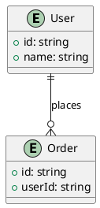
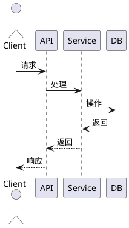

# {方案标题}

>日期： YYYY-MM-DD
>
>关联需求：docs/features/<迭代>/<CODE>-<slug>/spec.md
>
>设计 design：docs/design/topics/{资源}-{操作}.md（实施后会写到原design文件）
>
>
>
>**plan一旦定稿就不修改。** 同一资源的二次改造新建 `plan-{slug}.md`（与 spec 同目录；横切放 `_chores/`），不修改原计划文件


> **实施进度**：`dev-build` 在同目录维护 `{本文件名去.md}-progress.md`（如 `plan-progress.md` / `plan-{slug}-progress.md`）。  
> Plan 只写粗「实施步骤」；细项与勾选只写在 progress，**不回写本 plan**。

## 1. 文档说明

### 1.1 背景

- 业务 / 技术动机
- 关联的 features 或 issue
- 关联的 design
- 关键决策点（讨论后定义的方向、放弃的备选方案等）

### 1.2 目标

- 实现目标：
- 技术边界：

------

## 2. 领域模型（PlantUML）



---

## 3. 数据库设计（SQL DDL）

```sql
-- 在此定义表结构（必须可执行）

CREATE TABLE user (
  id VARCHAR(64) PRIMARY KEY,
  name VARCHAR(255) NOT NULL
);

CREATE TABLE `order` (
  id VARCHAR(64) PRIMARY KEY,
  user_id VARCHAR(64) NOT NULL
);
```

---

## 4. API 设计（OpenAPI）

```yaml
openapi: 3.0.0
info:
  title: XXX API
  version: 1.0.0

paths:
  /example:
    post:
      summary: 示例接口
      requestBody:
        required: true
        content:
          application/json:
            schema:
              type: object
              properties:
                field:
                  type: string
      responses:
        '200':
          description: 成功响应
```

---

## 5. 时序图（PlantUML）



---

## 6. 专题设计（Markdown）

### 6.1 权限设计

* （鉴权方式，如 JWT / Session）
* （权限模型，如 RBAC / ABAC）

### 6.2 并发控制

* （乐观锁 / 悲观锁）
* （幂等设计）

### 6.3 事务设计

* （单体事务 / 分布式事务）
* （一致性策略）

### 6.4 异常处理

* （错误码规范）
* （统一返回结构）

### 6.5 性能设计

* （缓存策略）
* （索引设计原则）

### 6.6 扩展性设计

* （服务拆分）
* （事件驱动 / 消息队列）

---

## 7. 一致性约束（必须遵守）

* 领域模型 ↔ 数据库字段必须一致
* 数据库 ↔ API 字段必须一致
* 枚举值必须统一定义
* 命名规范统一（如：API camelCase，DB snake_case）

------

## 8. 单元测试设计

### 8.1 测试范围

* 被测单元粒度：（单个类 / 单个方法）
* 依赖处理：（Mock / Stub / Fake / Spy 的使用边界）
* 测试隔离：（独立、无副作用、可并行）

### 8.2 测试策略

* 用例组织：（AAA 模式 Arrange-Act-Assert / Given-When-Then）
* 设计原则：（FIRST：Fast / Independent / Repeatable / Self-Validating / Timely）
* 测试框架：（JUnit 5 / Mockito / AssertJ）

### 8.3 用例覆盖场景

每个被测单元的用例需覆盖以下场景：

- [ ] 正常场景：合法输入，验证正确输出
- [ ] 边界场景：最大/最小值、临界值
- [ ] 异常场景：非法输入、越界、抛出预期异常
- [ ] 特殊值：null、0、空字符串、空集合
- [ ] 分支覆盖：每个 if/else、switch 分支
- [ ] 状态机：状态流转与非法跳转
- [ ] 并发幂等：竞态、重复调用
- [ ] 一致性约束：领域模型↔数据库字段、枚举值校验（关联第 7 节）

### 8.4 测试质量

* 命名规范：（should_xxx_when_yyy / given_when_then）
* 断言规范：（单一断言焦点 / 精准断言 / AssertJ）
* 数据构造：（TestDataBuilder / Object Mother）
* 覆盖率目标：（行覆盖 / 分支覆盖 阈值，如 ≥ 80%）
* 覆盖率排除：（DTO / 配置类 / generated code）

### 8.5 用例清单

| 被测单元 | 场景类型 | 用例说明 | 预期结果 | 关联章节 |
| :------: | :------: | :------: | :------: | :------: |
|          |          |          |          |          |

------

## 9. API 集成测试设计

### 9.1 测试范围

* 切片类型：（Controller 切片 / Repository 切片 / 全链路集成）
* 真实加载组件：（Controller / Service / Repository / ...）
* Mock 边界：（外部服务 / 第三方接口 / 消息队列 / 下游 RPC）

### 9.2 测试环境

* 数据库：（H2 内存库 / Testcontainers MySQL）
* 中间件：（Redis / MQ 依赖方案）
* 下游服务：（WireMock / MockServer）
* 迁移脚本：是否执行真实 Flyway 脚本（是 / 否）

### 9.3 用例覆盖场景

- [ ] 契约校验：状态码、请求/响应字段、错误返回结构
- [ ] 鉴权场景：无 token / 失效 token / 越权角色
- [ ] 业务闭环：完整业务流程串联
- [ ] 数据一致性：写入后查询验证、跨表对齐
- [ ] 并发幂等：重复请求、并发写入
- [ ] 下游异常：超时 / 失败 / 降级

### 9.4 测试数据

* 数据准备：（@Sql / @BeforeEach / TestDataBuilder）
* 隔离策略：（事务回滚 / 清表）
* 断言规范：（JSONPath / AssertJ）

### 9.5 用例清单

| 接口 | 场景类型 | 用例说明 | 预期结果 | 关联章节 |
| :--: | :------: | :------: | :------: | :------: |
|      |          |          |          |          |

---

## 10. E2E 测试设计

### 10.1 测试范围

* 核心业务闭环：（列出 P0 链路，如 下单→支付→发货）
* 覆盖边界：（端到端全链路，不 Mock 内部组件）
* 数量约束：（核心链路 N 条）

### 10.2 测试环境

* 部署方式：（Docker Compose / Testcontainers 全套）
* 依赖服务：（DB / Redis / MQ / 下游）
* 测试账号 / 种子数据：（可重入 / 可自清理）
* 外部第三方：（沙箱 / Mock，注明）

### 10.3 用例覆盖场景

- [ ] 核心业务 user journey：完整业务闭环
- [ ] 状态流转：状态机端到端跳转
- [ ] 数据落库验证：接口成功后查 DB 校验
- [ ] 异步链路：消息发送→消费→副作用（显式等待）
- [ ] 跨服务联动：服务间调用、最终一致性
- [ ] 前端交互（可选）：浏览器驱动 E2E

### 10.4 稳定性与诊断

* 等待策略：（显式等待 / 禁止硬等待）
* Flaky 处理：（重试策略 + 记录）
* 失败诊断产物：（截图 / 录屏 / HAR / 日志）

### 10.5 执行策略

* 运行时机：（夜跑 / 发版前 / 手动触发）
* 并行化：（是 / 否）
* 环境治理：（专用 E2E 环境 / 数据重置）

### 10.6 用例清单

| 链路名称 | 覆盖步骤 | 验证点 | 关联章节 |
| :------: | :------: | :----: | :------: |
|          |          |        |          |

------

## 11. 修改清单

### 11.1 代码修改

#### 11.1.1 修改{模块/资源}

**修改** `src/main/java/.../File.java`

- 改动点1
- 改动点2
- ...

源代码（原功能概述）：

```
涉及修改的源代码内容
```

变动后的代码（新功能概述）

```
新代码内容
```


#### 11.1.2 新增{模块/资源}

- 用途与职责
- 关键方法签名


#### 11.1.3 删除{模块/资源}

- 用途与职责
- 删除原因
- 删除影响

#### ...


#### 11.1.x 关键文件速查

| 操作 |              文件              | 备注 |
| :--: | :----------------------------: | :--: |
| 新增 | `src/main/java/.../FIlEA.java` |      |
| 新增 | `src/main/java/.../FIlEB.java` |      |
| ...  |             `...`              |      |
| 修改 | `src/main/java/.../FIlEC.java` |      |
| 修改 | `src/main/java/.../FIlED.java` |      |
| ...  |             `...`              |      |
| 删除 | `src/main/java/.../FIlEE.java` |      |
| 删除 | `src/main/java/.../FIlEF.java` |      |
| ...  |             `...`              |      |

### 11.2 接口变更

|    路径     | 方法 | 变更类型 | 说明 |      |
| :---------: | :--: | :------: | :--: | :--: |
| `/api/xxx`  | POST |   新增   | xxxx |      |
| `/api/xxx1` | GET  |   修改   | xxxx |      |


### 11.3 数据库变更

- FLyway 脚本：`V{N}__{desc}.sql`

-  

- 影响表： 

  - `table_b`（新建）

    - 原因：xxxx

    - 影响：xxxx

    - sql脚本：

      ```sql
      对应sql脚本
      ```

  - `tabel_a`（加字段 `xxx`）

    - 原因：xxxx

    - 影响：xxxx

    - sql脚本：

      ```sql
      对应sql脚本
      ```

  - `table_b`（删字段 `xxx`）

    - 原因：xxxx

    - 影响：xxxx

    - sql脚本：

      ```sql
      对应sql脚本
      ```

      

- 数据迁移：

  - 迁移原因：xxxx
  - 迁移方案：对应``V{N}__{desc}.sql`
  - 注意事项：xxx
  - 回滚方案：xxx

------

## 12. 实施步骤（粗）

> 5～10 条以内，供评审与 `dev-build` 展开细 checklist。不要在此写到文件级任务。

1. 领域与持久化
2. 应用服务与 API
3. 前端页面与联调
4. 测试与验证
5. 事实文档同步

------

## 13. 验证步骤

1. 本地启动后调 `curl ...`  期望返回 ...

2. 检查数据库 `select ... from ... where ...`

3. 看日志 grep `xxx`

   ------

## 14. 风险与回滚

- 风险点：xxxx

- 回滚方案：Flyway 脚本 `V{N+1}__rollback_xxx.sql`，或代码会退到上一个commit

  ------

## 15. 实施后需更新的 design 文档

- `docs/design/topics/{主题}.md`（新建/更新）

  ------

## 16. 变更记录（可选）

| 版本 | 日期       | 变更内容 |
| ---- | ---------- | -------- |
| v1.0 | YYYY-MM-DD | 初始版本 |
