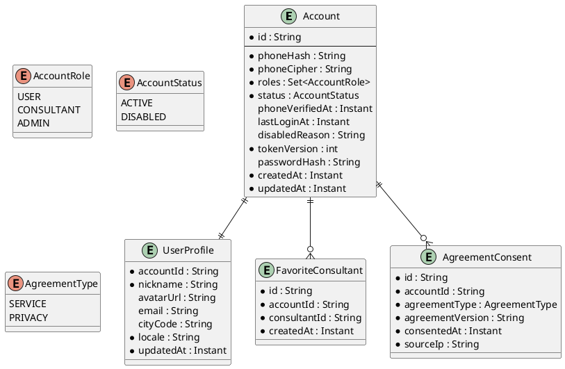
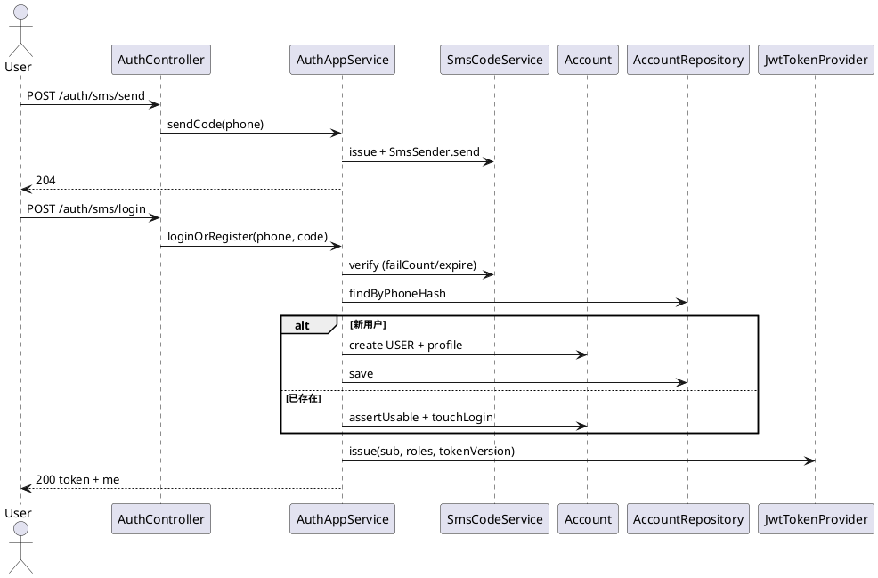
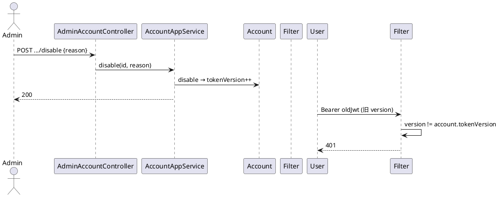

# ACC · 账号与个人中心 — 技术方案

>日期： 2026-11-17
>
>关联需求：docs/features/iteration1/ACC-account/spec.md
>
>关联 HLD：docs/features/iteration1/high-level-design.md（**已确认** 2026-11-17）
>
>**plan一旦定稿就不修改。** 二次改造新建 `plan-{slug}.md`。

> **实施进度**：由 `dev-build` 维护同目录 `plan-progress.md`；细项只写 progress，不回写本 plan。
>
> 状态：**待确认** — 确认前不写业务实现代码。

## 1. 文档说明

### 1.1 背景

- 工程为空壳；ACC 是其余模块的鉴权与账号前置（HLD §4：Account / 角色由 ACC 提供）。
- 规格：手机号验证码注册登录、多角色 Account、资料、收藏、协议同意、管理员禁用与会话失效。
- 原型：`prototypes` `/user/login`、`/user/profile`（样式参考；规则以 spec 为准）。

### 1.2 目标

- **实现目标**：落地 AC-001～AC-005 与 R-CREATE/QUERY/UPDATE/DELETE/COMMON 相关规则；JWT 上下文可被后续 feature 复用。
- **技术边界**：
  - 遵循 HLD / ADR-001～005；路径 `containers/backend`、`containers/frontend`。
  - **不**实现 OAuth、完整 RBAC 配置台、咨询师档案（COB）、可展示检索（CDC）。
  - 短信通道：本期 **SmsSender 端口 + 本地/测试 Mock**（真短信归后续 PLT，不阻塞 ACC）。
  - 收藏的「可展示咨询师」校验：ACC 定义 `DisplayableConsultantPort`；本期提供 **可替换 Stub**（测试种子 ID 可展示），CDC/COB Plan 替换为真实现。
  - 扩展 JWT Claims：`roles` 多值 + `tokenVersion`（禁用抬版本使旧会话失效）；不改为 Session。

### 1.3 关键决策（本 Plan）

| ID | 决策 | 说明 |
|---|---|---|
| P-001 | USER/CONSULTANT：手机号 + 短信验证码登录/注册合一 | 已有手机号不重复建号（R-CREATE-001） |
| P-002 | ADMIN：平台种子/分配账号 + **密码**登录（独立鉴权） | 不开放自助注册 ADMIN（R-COMMON-001） |
| P-003 | 手机号：存 `phone_hash`（唯一查询）+ `phone_cipher`（可逆展示给本人） | 满足「库内加密」与唯一登录 |
| P-004 | 禁用抬升 `token_version`，JWT 携带同名字段，过滤器不一致则 401 | 满足「现有会话失效」 |
| P-005 | 验证码：DB 表存储（无 Redis 依赖），TTL + 失败次数 | 连续 5 次失败作废（R-CREATE-002） |

---

## 2. 领域模型（PlantUML）



聚合根：**Account**（角色集合、状态机、tokenVersion、登录校验）。  
UserProfile / FavoriteConsultant / AgreementConsent：由 Account 用例编排持久化；AgreementConsent **不可变、不可物理删**。

领域能力（示意）：

- `Account.registerOrLoginByPhone(...)` / `Account.loginAsAdmin(...)`
- `Account.disable(reason)` / `Account.enable()` → 抬升 `tokenVersion`
- `Account.grantConsultantRole()` — 幂等（供 COB 调用，ACC 暴露 Domain/App API）
- `Account.assertUsable()` — disabled 拒绝

---

## 3. 数据库设计（SQL DDL）

Flyway：`containers/backend/src/main/resources/db/migration/V20261117__acc_account.sql`  
测试：`schema.sql` / `data.sql` 同步；种子 1 个 ADMIN（手机号约定见验证步骤）。

```sql
CREATE TABLE account (
  id                VARCHAR(64)  NOT NULL PRIMARY KEY,
  phone_hash        VARCHAR(64)  NOT NULL,
  phone_cipher      VARCHAR(512) NOT NULL,
  roles_json        VARCHAR(128) NOT NULL COMMENT 'JSON array e.g. ["USER"]',
  status            VARCHAR(32)  NOT NULL,
  phone_verified_at DATETIME(3)  NOT NULL,
  last_login_at     DATETIME(3)  NULL,
  disabled_reason   VARCHAR(200) NULL,
  token_version     INT          NOT NULL DEFAULT 0,
  password_hash     VARCHAR(255) NULL COMMENT 'ADMIN only',
  created_at        DATETIME(3)  NOT NULL,
  updated_at        DATETIME(3)  NOT NULL,
  UNIQUE KEY uk_account_phone_hash (phone_hash)
);

CREATE TABLE user_profile (
  account_id   VARCHAR(64)  NOT NULL PRIMARY KEY,
  nickname     VARCHAR(30)  NOT NULL,
  avatar_url   VARCHAR(500) NULL,
  email        VARCHAR(254) NULL,
  city_code    VARCHAR(20)  NULL,
  locale       VARCHAR(16)  NOT NULL DEFAULT 'zh-CN',
  updated_at   DATETIME(3)  NOT NULL,
  CONSTRAINT fk_profile_account FOREIGN KEY (account_id) REFERENCES account(id)
);

CREATE TABLE favorite_consultant (
  id             VARCHAR(64) NOT NULL PRIMARY KEY,
  account_id     VARCHAR(64) NOT NULL,
  consultant_id  VARCHAR(64) NOT NULL,
  created_at     DATETIME(3) NOT NULL,
  UNIQUE KEY uk_fav_account_consultant (account_id, consultant_id),
  KEY idx_fav_account (account_id),
  CONSTRAINT fk_fav_account FOREIGN KEY (account_id) REFERENCES account(id)
);

CREATE TABLE agreement_consent (
  id                 VARCHAR(64)  NOT NULL PRIMARY KEY,
  account_id         VARCHAR(64)  NOT NULL,
  agreement_type     VARCHAR(32)  NOT NULL,
  agreement_version  VARCHAR(20)  NOT NULL,
  consented_at       DATETIME(3)  NOT NULL,
  source_ip          VARCHAR(45)  NOT NULL,
  KEY idx_consent_account (account_id),
  UNIQUE KEY uk_consent_account_type_ver (account_id, agreement_type, agreement_version),
  CONSTRAINT fk_consent_account FOREIGN KEY (account_id) REFERENCES account(id)
);

CREATE TABLE sms_verification_code (
  id            VARCHAR(64)  NOT NULL PRIMARY KEY,
  phone_hash    VARCHAR(64)  NOT NULL,
  code_hash     VARCHAR(64)  NOT NULL,
  expires_at    DATETIME(3)  NOT NULL,
  fail_count    INT          NOT NULL DEFAULT 0,
  used_at       DATETIME(3)  NULL,
  created_at    DATETIME(3)  NOT NULL,
  KEY idx_sms_phone_created (phone_hash, created_at)
);
```

---

## 4. API 设计（OpenAPI）

前缀 `/api/v1`。错误体沿用 `GlobalExceptionHandler`（`PARAM_ERROR` / `BUSINESS_CONFLICT` / `VALIDATION_ERROR`）。

```yaml
openapi: 3.0.0
info:
  title: ACC Account API
  version: 0.1.0
paths:
  /api/v1/auth/sms/send:
    post:
      summary: 发送登录/注册验证码
      requestBody:
        required: true
        content:
          application/json:
            schema:
              type: object
              required: [phone]
              properties:
                phone: { type: string }
      responses:
        '204': { description: 已接受（防枚举不区分新老号） }
        '400': { description: 手机号非法 / 发送过频 }
  /api/v1/auth/sms/login:
    post:
      summary: 验证码登录或注册（默认 USER）
      requestBody:
        required: true
        content:
          application/json:
            schema:
              type: object
              required: [phone, code]
              properties:
                phone: { type: string }
                code: { type: string }
                nickname: { type: string, description: 新号可选，缺省生成 }
      responses:
        '200':
          description: token + account + profile
  /api/v1/auth/admin/login:
    post:
      summary: 管理员密码登录
      requestBody:
        required: true
        content:
          application/json:
            schema:
              type: object
              required: [phone, password]
              properties:
                phone: { type: string }
                password: { type: string }
      responses:
        '200': { description: token + account }
  /api/v1/me:
    get:
      summary: 当前账号与资料
      security: [{ bearerAuth: [] }]
      responses:
        '200': { description: MeResponse }
  /api/v1/me/profile:
    put:
      summary: 更新本人资料
      security: [{ bearerAuth: [] }]
      requestBody:
        required: true
        content:
          application/json:
            schema:
              type: object
              properties:
                nickname: { type: string }
                avatarUrl: { type: string }
                email: { type: string }
                cityCode: { type: string }
                locale: { type: string }
      responses:
        '200': { description: UserProfileResponse }
  /api/v1/me/favorites:
    get:
      summary: 收藏列表
      security: [{ bearerAuth: [] }]
      responses:
        '200': { description: FavoriteItem[] }
    post:
      summary: 收藏咨询师（幂等）
      security: [{ bearerAuth: [] }]
      requestBody:
        required: true
        content:
          application/json:
            schema:
              type: object
              required: [consultantId]
              properties:
                consultantId: { type: string }
      responses:
        '200': { description: FavoriteItem }
  /api/v1/me/favorites/{consultantId}:
    delete:
      summary: 取消收藏（幂等成功）
      security: [{ bearerAuth: [] }]
      responses:
        '204': { description: OK }
  /api/v1/me/agreements:
    post:
      summary: 记录协议同意（按类型+版本幂等）
      security: [{ bearerAuth: [] }]
      requestBody:
        required: true
        content:
          application/json:
            schema:
              type: object
              required: [agreementType, agreementVersion]
              properties:
                agreementType: { type: string, enum: [service, privacy] }
                agreementVersion: { type: string }
      responses:
        '200': { description: AgreementConsentResponse }
    get:
      summary: 查询本人同意记录
      security: [{ bearerAuth: [] }]
      responses:
        '200': { description: AgreementConsentResponse[] }
  /api/v1/admin/accounts/{id}/disable:
    post:
      summary: 禁用账号
      security: [{ bearerAuth: [] }]
      requestBody:
        required: true
        content:
          application/json:
            schema:
              type: object
              required: [reason]
              properties:
                reason: { type: string, maxLength: 200 }
      responses:
        '200': { description: AccountResponse }
  /api/v1/admin/accounts/{id}/enable:
    post:
      summary: 启用账号
      security: [{ bearerAuth: [] }]
      responses:
        '200': { description: AccountResponse }
```

SecurityConfig：放行 `POST /api/v1/auth/**`；`/api/v1/admin/**` 需 `ROLE_ADMIN`（JWT authority）；`/api/v1/me/**` 需登录。  
咨询师端路由守卫（前端 + 可选后端 `/api/v1/consultant/**` 预留）：无 `CONSULTANT` 角色 → 403（EX-003）；本 Plan 至少提供 **鉴权工具方法** `SecurityUtils.hasRole("CONSULTANT")`，完整咨询师 API 属后续 feature。

---

## 5. 时序图（PlantUML）

### 5.1 验证码登录/注册



### 5.2 管理员禁用 → 旧 Token 失效



---

## 6. 专题设计

### 6.1 权限设计

- JWT HMAC-SHA256；Claims：`sub`=accountId，`roles`（数组），`tokenVersion`，`iat`/`exp`。
- Filter：验签 → 查库或缓存校验 status=ACTIVE 且 version 一致 → `UserContext`（accountId + roles）。
- PR-001～004：未登录 401；admin 接口 `hasRole('ADMIN')`；无 CONSULTANT 访问咨询师端 403。

### 6.2 并发控制

- 收藏 / 协议同意：DB 唯一键 + 捕获冲突后转幂等成功（R-CREATE-004、同意幂等）。
- 发码：同手机号短时限流（如 60s 内不可重发）→ `BUSINESS_CONFLICT` 或 `PARAM_ERROR`（文案明确）。

### 6.3 事务设计

- `AuthAppService.loginOrRegister`、`updateProfile`、`disable` 等写用例 `@Transactional` 在 application 层。

### 6.4 异常处理

| 场景 | 异常 | errorCode |
|---|---|---|
| 验证码错误/过期/作废 | IllegalArgumentException | PARAM_ERROR |
| 账号禁用 | IllegalStateException 或统一 401 + 明确文案 | BUSINESS_CONFLICT / 401 |
| 非法状态流转 | IllegalStateException | BUSINESS_CONFLICT |
| 收藏不可展示咨询师 | IllegalArgumentException | PARAM_ERROR |

### 6.5 性能设计

- `phone_hash` / 收藏唯一索引；验证码按 phone_hash + 时间检索最近一条。
- 头像仅存 URL（上传服务本期可 Mock 前端直传占位，不建对象存储）。

### 6.6 扩展性设计

- `SmsSender`、`PhoneCrypto`、`DisplayableConsultantPort` 端口在 domain/application，infrastructure 可替换。
- `grantConsultantRole` 供 COB 应用服务调用（同进程 Bean），不开放用户自助提权。

---

## 7. 一致性约束

- 字段枚举与 spec §5 一致：`active/disabled` → DB/API 用 `ACTIVE`/`DISABLED`（对外 JSON 可用小写枚举，须在 Assembler 统一）。
- 协议类型 API：`service` / `privacy` ↔ 领域 `SERVICE` / `PRIVACY`。
- 角色 JWT authority：`ROLE_USER` / `ROLE_CONSULTANT` / `ROLE_ADMIN`（与 Spring `hasRole` 对齐）。
- 手机号仅本人 `me` 接口返回明文（解密）；列表/管理视图按 R-QUERY-002 脱敏（管理员审计场景可后续 ADM 细化，本期 admin disable 按 id 操作即可）。
- 命名：API camelCase，DB snake_case。

---

## 8. 单元测试设计

### 8.1 范围

- `Account` 状态机、角色幂等授予、tokenVersion。
- `SmsCodeService` 校验/失败次数/过期。
- Phone 规范化与 hash 稳定性。

### 8.5 用例清单（摘要）

| 被测单元 | 场景 | 预期 |
|---|---|---|
| Account.disable | 填原因 | status=DISABLED，version+1 |
| Account.disable | 重复禁用 | 幂等 |
| Account.grantConsultantRole | 已有角色 | 不变 |
| SmsCodeService.verify | 错 5 次 | 作废 |
| SmsCodeService.verify | 过期 | 失败 |

---

## 9. API 集成测试设计

### 9.1 范围

RestAssured + 现有 TestBase/ResetDb；需可用 MySQL（或项目既定测试库）。覆盖 AC-001～005 主路径。

### 9.5 用例清单

| 接口 | 场景 | 预期 | 关联 |
|---|---|---|---|
| POST /auth/sms/login | 新号+正确码 | 200，角色含 USER | AC-001 |
| POST /auth/sms/login | 错误码 | 400 | R-CREATE-002 |
| PUT /me/profile | 本人修改 | 200 再 GET 一致 | AC-002 |
| PUT /me/profile | 无 token | 401 | PR-001 |
| POST/DELETE favorites | 幂等收藏取消 | 列表正确 | AC-003 |
| POST /me/agreements | 双协议版本 | 落库 IP/时间 | AC-004 |
| POST admin disable + 旧 token | 访问 /me | 401 | AC-005 |

---

## 10. E2E 测试设计

### 10.1 范围

对齐原型路由：`/user/login`、`/user/profile`。文本用例写入 `docs/test-cases/e2e-cases/`（QA），自动化 `e2e/tests/qa/`（可与 qa-write-cases 并行补）。

### 10.6 用例清单

| 链路 | 步骤 | 验证 |
|---|---|---|
| 注册登录 | 发码（测试后门或固定 Mock 码）→ 登录 | 进入个人中心 |
| 改资料 | 改昵称保存 | 刷新仍在 |
| 收藏 | 收藏种子咨询师 → 取消 | 列表变化 |
| 禁用 | Admin 禁用后用户旧会话 | 被踢/无法访问 |

测试环境验证码：`SmsSender` Mock + 测试配置固定码或读最新码表（仅 test profile）。

---

## 11. 修改清单

### 11.1 关键文件速查

| 操作 | 文件 | 备注 |
| :--: | :-- | :-- |
| 新增 | `.../domain/aggregate/Account.java` | 聚合根 |
| 新增 | `.../domain/aggregate/UserProfile.java` 等 | 实体/值对象 |
| 新增 | `.../domain/repository/AccountRepository.java` | |
| 新增 | `.../domain/service/PhoneCrypto.java`、`SmsSender.java`、`DisplayableConsultantPort.java` | 端口 |
| 新增 | `.../application/service/AuthAppService.java`、`ProfileAppService.java`、`FavoriteAppService.java`、`AgreementAppService.java`、`AdminAccountAppService.java` | |
| 新增 | `.../application/assembler/*Assembler.java` | |
| 新增 | `.../adapter/rest/AuthController.java`、`MeController.java`、`AdminAccountController.java` | |
| 新增 | `.../adapter/rest/dto/**` | Command/Response |
| 新增 | `.../infrastructure/persistence/po|mapper|converter/**` | |
| 新增 | `.../infrastructure/repositoryimpl/*RepositoryImpl.java` | |
| 新增 | `.../infrastructure/sms/MockSmsSender.java` | |
| 新增 | `.../infrastructure/crypto/AesPhoneCrypto.java` | |
| 新增 | `.../infrastructure/consultant/StubDisplayableConsultantPort.java` | |
| 修改 | `.../infrastructure/security/JwtTokenProvider.java` | roles + tokenVersion |
| 修改 | `.../infrastructure/security/JwtAuthenticationFilter.java` | version/status 校验 |
| 修改 | `.../infrastructure/security/UserContext.java` | roles 集合 |
| 修改 | `.../infrastructure/config/SecurityConfig.java` | 放行 auth |
| 新增 | `db/migration/V20261117__acc_account.sql` | |
| 修改 | `src/test/resources/schema.sql`、`data.sql` | |
| 新增 | `src/test/java/.../AuthControllerTest.java` 等 | |
| 新增 | `containers/frontend/src/views/auth/Login.vue`、`views/user/Profile.vue` | |
| 修改 | `containers/frontend/src/router/index.ts`、`stores/auth.ts`、`services/*` | |
| 修改 | `docs/facts/api.yaml`、`db-schema.md`、`domain-model.md`、`tech-topic/security.md`、`data-dict.md` | 实施后 |
| 修改 | `docs/architecture/tech/adr.md`（ADR-004）/ `docs/facts/tech-topic/security.md` | Claims 扩展说明（非推翻 HMAC） |

### 11.2 接口变更

| 路径 | 方法 | 类型 | 说明 |
|---|---|---|---|
| `/api/v1/auth/sms/send` | POST | 新增 | 发码 |
| `/api/v1/auth/sms/login` | POST | 新增 | 登录/注册 |
| `/api/v1/auth/admin/login` | POST | 新增 | 管理员 |
| `/api/v1/me` | GET | 新增 | 当前用户 |
| `/api/v1/me/profile` | PUT | 新增 | 改资料 |
| `/api/v1/me/favorites` | GET/POST | 新增 | 收藏 |
| `/api/v1/me/favorites/{consultantId}` | DELETE | 新增 | 取消 |
| `/api/v1/me/agreements` | GET/POST | 新增 | 协议 |
| `/api/v1/admin/accounts/{id}/disable\|enable` | POST | 新增 | 禁用启用 |

### 11.3 数据库变更

- 脚本：`V20261117__acc_account.sql`（§3 全量新建）。
- 无历史业务表迁移；本地旧库建议重建。

---

## 12. 实施步骤（粗）

1. 领域模型、枚举、仓库接口与端口（含 PhoneCrypto / SmsSender / DisplayableConsultantPort）
2. Flyway + PO/Mapper/Converter/RepositoryImpl + 测试 schema/data 种子 ADMIN
3. Auth / Profile / Favorite / Agreement / Admin 应用服务与 Assembler、事务与幂等
4. REST API、Security/JWT/UserContext 改造、全局错误语义对齐
5. 前端登录页与个人中心（对齐原型路由）、auth store 与拦截器
6. 开发自测（单元 + API）与 E2E/QA 文本用例挂钩
7. 同步 `docs/facts/` 与 JWT ADR Claims 说明

---

## 13. 验证步骤

1. `POST /api/v1/auth/sms/send` + Mock 码 → `POST .../login` → 200 含 token；`GET /api/v1/me` 成功。
2. 改昵称 `PUT /me/profile` → 再 GET 一致。
3. 对 Stub 可展示 `consultantId` 收藏/取消，重复操作不报错。
4. 提交 service+privacy 同意后 GET 可见版本与 IP。
5. Admin 登录 → disable 用户 → 用户旧 Bearer 访问 `/me` 为 401。
6. `mvn test`、前端 `npm run build`；可选 `e2e` 冒烟登录页。

---

## 14. 风险与回滚

| 风险 | 缓解 |
|---|---|
| JWT Claims 变更影响空壳旧 token | 空壳无业务 token；文档标明不兼容旧 demo |
| 收藏依赖咨询师主数据 | Stub 端口 + 种子 ID；CDC 替换前 E2E 用种子 |
| 手机加密密钥泄漏 | 密钥仅配置/环境变量；禁止入仓 |
| 无 Redis 验证码表膨胀 | TTL 任务或登录前清理过期行（可简单实现） |

回滚：Revert 合并提交 + 删除 Flyway 脚本并重建库（无生产数据）。

---

## 15. 实施后需更新的事实文档

- `docs/facts/api.yaml`
- `docs/facts/db-schema.md`
- `docs/facts/domain-model.md`
- `docs/facts/tech-topic/security.md`、`data-dict.md`；Claims 对齐 ADR-004（`docs/architecture/tech/adr.md`）
- `docs/facts/tech-topic/error-code.md`（若新增对外文案映射）
- `AGENTS.md` §8 聚合简述（Account 等）
- `docs/test-cases/e2e-cases/test-cases.md`（ACC 相关 TC）

**docs 同步检查**：涉及。

---

## 16. 变更记录

| 版本 | 日期 | 变更内容 |
| ---- | ---------- | -------- |
| v1.0 | 2026-11-17 | 初稿，待确认 |

---

## 确认清单（人工）

- [ ] 同意 P-001～P-005 与 Stub 收藏端口策略
- [ ] 同意 ADMIN 密码登录 + USER 短信登录
- [ ] 确认后进入 TDD / `dev-build`（先 progress，不改本 plan）
