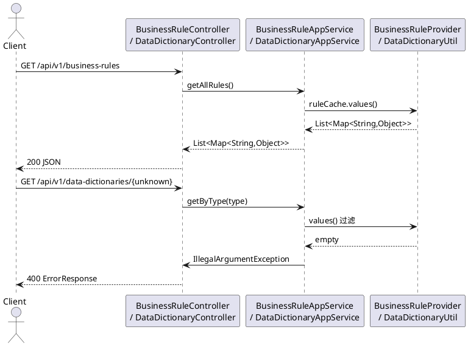

# 补齐 BusinessRule / DataDictionary API 集成测试

> 日期：2026-11-06
>
> 关联需求：不涉及（本轮不引入新需求，修复的是 AGENTS.md §10 已写明的规范缺口）
>
> 设计 design：docs/designs/topic/businessrule.md、docs/designs/topic/data-dict.md
>
>
> **plan 一旦定稿就不修改。** 同一资源的二次改造新建 `YYYY-MM-DD-{slug}.md`，不修改原计划文件

## 1. 文档说明

### 1.1 背景

`AGENTS.md` §10「开发自测覆盖要求」写得很硬：

> 每个 API **必须** 有对应的集成测试
> 至少覆盖：1 个 Happy Path + 关键失败分支（参数错误 / 权限不足 / 业务冲突）

现状盘点 —— `backend/src/test/java/com/consultation/adapter/rest/`：

| Controller | 集成测试 | 状态 |
|---|---|---|
| `AdminController` | `AdminControllerTest`（6 例） | ✅ |
| `AppointmentController` | `AppointmentControllerTest`（3 例） | ✅ |
| `AuthController` | `AuthControllerTest`（3 例） | ✅ |
| `ConsultantController` | `ConsultantControllerTest`（3 例） | ✅ |
| `UserController` | `UserControllerTest`（3 例） | ✅ |
| `BusinessRuleController` | — | ❌ **缺** |
| `DataDictionaryController` | — | ❌ **缺** |
| `HomeController` | — | ❌ 缺（纯静态页，无业务规则，留待后续） |

两个缺口都不是"锦上添花"，而是 **对外暴露的公开读接口**，且都 `permitAll`（无需鉴权即可访问），
一旦字段结构漂移（ruleName 改名、字典类型漏注册）不会有任何编译错误，只会静默返回错数据。

关键决策点：

- **只补测试，不动生产代码。** 这两个 Controller 的实现（`BusinessRuleAppService` / `DataDictionaryAppService`）
  本身没有问题，缺的是"证明它们是对的"的用例。改动面越窄，评审与回滚成本越低。
- **本轮不写 QA 用例。** QA 用例针对"需求规格的验收标准"，本轮没有新需求、没有契约变更，
  按 `AGENTS.md` §10 的分层定义，QA 用例库不需要新增条目（见 §11.4 同步检查）。

### 1.2 目标

- 实现目标：
  - 新增 `BusinessRuleControllerTest`，覆盖 `GET /api/v1/business-rules` 的 happy path、规则完整性、YAML 配置透出、免鉴权
  - 新增 `DataDictionaryControllerTest`，覆盖 `GET /api/v1/data-dictionaries` 与 `GET /api/v1/data-dictionaries/{type}` 的 happy path、大小写不敏感、字典项内容、未知类型失败分支
- 技术边界：
  - **只新增 2 个测试文件**，`backend/src/main/**` 一行不动
  - 不引入新依赖（RestAssured + JUnit 5 + Hamcrest 均已在 `pom.xml`）
  - 不改数据库、不改 API 契约、不改前端

------

## 2. 领域模型（PlantUML）

本轮不涉及 —— 无领域模型变更。仅在 §9 断言已有模型对外投影的结果。

## 3. 数据库设计（SQL DDL）

本轮不涉及 —— 无表结构变更。目标接口不读写数据库。

## 4. API 设计（OpenAPI）

本轮不涉及 —— **无 API 契约变更**。目标接口的现有契约（只读，仅此如下，不做任何修改）：

```yaml
openapi: 3.0.0
info:
  title: 业务规则 / 数据字典 API（现有契约，本轮不改）
  version: 1.0.0
paths:
  /api/v1/business-rules:
    get:
      summary: 列出全部业务规则
      responses:
        '200':
          description: 规则数组
          content:
            application/json:
              schema:
                type: array
                items:
                  type: object
                  properties:
                    ruleName:    { type: string }
                    description: { type: string }
                    config:      { type: object }
  /api/v1/data-dictionaries:
    get:
      summary: 列出全部数据字典类型
      responses:
        '200': { description: 字典数组 }
  /api/v1/data-dictionaries/{type}:
    get:
      summary: 按类型取数据字典
      parameters:
        - name: type
          in: path
          required: true
          schema: { type: string }
      responses:
        '200': { description: 单个字典 }
        '400': { description: 字典类型不存在 }
```

## 5. 时序图（PlantUML）



------

## 6. 专题设计（Markdown）

### 6.1 权限设计

`SecurityConfig` 中 `/api/v1/data-dictionaries/**` 与 `/api/v1/business-rules/**` 均为 `permitAll`。
本轮新增用例 **一律不带 token**，顺带把"这两个接口免鉴权"这条契约钉死 —— 将来有人误加
`.authenticated()` 时，用例会立刻红。

### 6.2 并发控制

不涉及（只读接口，无写操作）。

### 6.3 事务设计

不涉及（只读，不涉及事务边界）。

### 6.4 异常处理

**这是本轮唯一的"契约断言"重点。**

`GET /api/v1/data-dictionaries/{type}` 传入未知类型时：

`DataDictionaryAppService.getByType()` → `IllegalArgumentException("字典类型不存在: " + typeName)`
→ `GlobalExceptionHandler.handleBadArg()` → HTTP 400，body 为 `ErrorResponse`：

```json
{
  "errorCode": "PARAM_ERROR",
  "errorMessage": "字典类型不存在: NOT_EXIST",
  "data": null
}
```

> ⚠️ **发现的既有文档不一致（本轮不修，仅记录）**
>
> `AGENTS.md` §7 给的示例 JSON 写的是 `"message"` 字段：
> ```json
> { "errorCode": "APPOINTMENT_CONFLICT", "message": "该时间段已被占用", "timestamp": "..." }
> ```
> 而 `GlobalExceptionHandler.ErrorResponse` 这个 record 的实际字段是
> **`errorCode` / `errorMessage` / `data`**，既没有 `message` 也没有 `timestamp`。
>
> 事实文档与代码不一致，按 `AGENTS.md` §13 的同步要求应当修正 `AGENTS.md` §7，
> 但那属于"改事实文档"而非"补测试"，**建议单独开一轮**处理，本轮不动 `AGENTS.md`。
>
> 本轮测试 **以代码实际契约为准**（断言 `errorCode` + `errorMessage`）。

### 6.5 性能设计

不涉及。

### 6.6 扩展性设计

不涉及。

------

## 7. 一致性约束（必须遵守）

* 断言里的字段名必须与实际 JSON 一致：
  * 业务规则项：`ruleName` / `description` / `config`
  * 数据字典：`typeName` / `description` / `items[]`，字典项 `code` / `description`
  * 错误响应：`errorCode` / `errorMessage` / `data`
* 枚举 code 一律等于枚举名（`Description.getCode()` → `name()`）：
  * `USER_ROLE` → `ROLE_USER` / `ROLE_ADMIN`
  * `USER_STATUS` → `ACTIVE` / `DISABLED`
  * `APPOINTMENT_STATUS` → `PENDING` / `CONFIRMED` / `COMPLETED` / `CANCELLED`
  * `CONSULTANT_STATUS` → `ACTIVE` / `DISABLED`
  * `BRANCH_STATUS` → `ACTIVE` / `DISABLED`
* 业务规则 `ruleName` 取自 `AppointmentRule` / `AuthRule` 枚举，共 **7 条**（4 + 3）
* 命名规范：
  * 测试类名 `{被测Controller}Test` → `BusinessRuleControllerTest` / `DataDictionaryControllerTest`
  * 方法名 `should_{action}_{expectedResult}`
  * **不写 `TC-` 编号** —— `TC-xxx` 是 QA 用例的编号体系，开发自测不进入编号空间
    （`AGENTS.md` §10 用例编号列：「开发自测 = 无编号，命名表达意图」）
* 归属：这两个文件属于 **开发自测**（验证"代码按 Plan 的设计工作"），
  **不是 QA 测试**，不进 `docs/test-cases/e2e-cases/`，也不进 `e2e/tests/qa/`

------

## 8. 单元测试设计

本轮不涉及 —— 不改 domain/application 层，不新增单元测试。
`BusinessRuleProvider` 的 YAML 装载逻辑与 `DataDictionaryUtil` 的投影逻辑
由 §9 的集成测试经由 HTTP 端到端覆盖。

------

## 9. API 集成测试设计

### 9.1 测试范围

* 切片类型：全链路集成（`@SpringBootTest(webEnvironment = RANDOM_PORT)` + RestAssured）
* 真实加载组件：Controller → AppService → domain（`BusinessRuleProvider` / `DataDictionaryUtil`）
* Mock 边界：**无**。两个接口都不触碰 DB，也不调外部服务，全链路真实
* 继承 `com.consultation.TestBase`（已含 `@BeforeEach` 的 `resetDbService.resetAll()`，
  本轮用例不写库，但沿用同一隔离机制，保证可重复执行、与执行顺序无关）

### 9.2 测试环境

* 数据库：MariaDB4j（`TestBase` 已配好）—— 本轮用例不读写
* 中间件：无
* 下游服务：无
* 迁移脚本：`spring.flyway.enabled=false`（test profile 已有）
* 鉴权：两个端点 `permitAll`，**用例不带 Authorization 头**

### 9.3 用例覆盖场景

- [x] 契约校验：状态码、响应字段、错误返回结构
- [x] 鉴权场景：免鉴权可访问（`permitAll` 契约）
- [x] 业务闭环：不涉及（只读接口）
- [x] 数据一致性：YAML 配置 → 接口透出；枚举 → 字典项
- [ ] 状态机 / 并发幂等 / 下游异常：不涉及（只读接口，无状态流转）

### 9.4 测试数据

* 数据准备：**不需要**。无 DB 写入
* 隔离策略：沿用 `TestBase.setUp()` 的 `resetDbService.resetAll()`
* 断言规范：RestAssured + Hamcrest（`not(empty())` / `hasItem` / `hasKey` / `containsString`）

### 9.5 用例清单

#### BusinessRuleControllerTest — `GET /api/v1/business-rules`

| # | 场景类型 | 用例说明 | 预期结果 | 关联章节 |
| :--: | :------: | :------ | :------ | :------ |
| 1 | 正常场景 | 列出全部业务规则 | 200；数组非空；长度为 7（4 条预约规则 + 3 条鉴权规则） | §7 |
| 2 | 正常场景 | 包含预约冲突检测规则 | 200；含 `ruleName == "appointment_conflict_detection"`，其 `description` 非空 | §7 |
| 3 | 正常场景 | 包含鉴权令牌过期规则 | 200；含 `ruleName == "auth_token_expiration"` | §7 |
| 4 | 数据一致性 | YAML 配置透出到 `config` | 200；每条规则含 `config`；`config.appointment.slot.minMinutes == 30`；`config.auth.token.expirationMs == 86400000` | §7 |
| 5 | 鉴权场景 | 不带 token 也能访问 | 200（`permitAll` 契约） | §6.1 |

#### DataDictionaryControllerTest

| # | 接口 | 场景类型 | 用例说明 | 预期结果 | 关联章节 |
| :--: | :--: | :------: | :------ | :------ | :------ |
| 1 | `GET /api/v1/data-dictionaries` | 正常场景 | 列出全部数据字典类型 | 200；长度为 5；每项 `typeName` / `description` / `items` 非空 | §7 |
| 2 | `GET /api/v1/data-dictionaries/USER_ROLE` | 正常场景 | 按类型取字典 | 200；`typeName == "USER_ROLE"`；`items` 含 `code == "ROLE_USER"` 与 `code == "ROLE_ADMIN"`，各自 `description` 非空 | §7 |
| 3 | `GET /api/v1/data-dictionaries/user_role` | 边界场景 | 类型名大小写不敏感 | 200；`typeName == "USER_ROLE"`（`equalsIgnoreCase` 契约） | §7 |
| 4 | `GET /api/v1/data-dictionaries/APPOINTMENT_STATUS` | 正常场景 | 状态字典项完整 | 200；`items` 含 `PENDING` / `CONFIRMED` / `COMPLETED` / `CANCELLED` 四个 code | §7 |
| 5 | `GET /api/v1/data-dictionaries/NOT_EXIST` | 异常场景 | 未知字典类型 | 400；`errorCode == "PARAM_ERROR"`；`errorMessage` 含 `"字典类型不存在"` | §6.4 |

**合计 10 个用例。** 覆盖 2 个 Controller 的全部对外方法与全部可达失败分支。

------

## 11. 修改清单

### 11.1 代码修改

**无。** `backend/src/main/**` 本轮一行不改。

### 11.1.2 新增文件

| 操作 | 文件 | 用途 |
| :--: | :-- | :-- |
| 新增 | `backend/src/test/java/com/consultation/adapter/rest/BusinessRuleControllerTest.java` | 5 个用例，覆盖 `GET /api/v1/business-rules` |
| 新增 | `backend/src/test/java/com/consultation/adapter/rest/DataDictionaryControllerTest.java` | 5 个用例，覆盖两个数据字典接口 |

#### 11.1.x 关键文件速查

| 操作 | 文件 | 备注 |
| :--: | :-- | :-- |
| 新增 | `backend/src/test/java/com/consultation/adapter/rest/BusinessRuleControllerTest.java` | 继承 `TestBase`，`should_*` 命名 |
| 新增 | `backend/src/test/java/com/consultation/adapter/rest/DataDictionaryControllerTest.java` | 继承 `TestBase`，`should_*` 命名 |

### 11.2 接口变更

无。

### 11.3 数据库变更

无。

### 11.4 文档同步检查

| 文档 | 是否需要更新 | 理由 |
|---|---|---|
| `docs/designs/api.yaml` | **不涉及** | 无 API 契约变更 |
| `docs/designs/db-schema.md` | **不涉及** | 无表结构变更 |
| `docs/designs/topic/businessrule.md` | **不涉及** | 规则定义未变，只是给它补了测试 |
| `docs/designs/topic/data-dict.md` | **不涉及** | 字典定义未变，只是给它补了测试 |
| `docs/test-cases/e2e-cases/test-cases.md` | **不涉及** | 属开发自测，不是 QA 用例；无新需求、无验收标准变化 |
| `AGENTS.md` §7 | **本轮不修，建议单独开一轮** | 见 §6.4 记录的 `ErrorResponse` 字段名不一致 |

---

## 12. 验证步骤

1. **基线（改动前）**：`cd backend && mvn -o -B test` → 期望 `Tests run: 18, Failures: 0, Errors: 0`
2. **实现后**：`cd backend && mvn -o -B test` → 期望 `Tests run: 28, Failures: 0, Errors: 0`
   （18 基线 + 10 新增）
3. **只看新用例**：`cd backend && mvn -o -B test -Dtest='BusinessRuleControllerTest,DataDictionaryControllerTest'`
   → 期望 `Tests run: 10, Failures: 0, Errors: 0`
4. **确认没碰生产代码**：`git status --short` → 只应出现 2 个新增测试文件
5. **确认没有引入 `TC-` 编号**：`grep -rn "TC-" backend/src/test/` → 无输出

---

## 13. 风险与回滚

* 风险点 1：**用例断言过细导致脆**。例如把 `config.appointment.slot.minMinutes == 30` 写死，
  将来 YAML 改了分钟数，用例会红 —— 这是**预期的**，配置项被改动本来就应该有测试提醒。
  但要避免断言整个 `config` 的 JSON 全等。
* 风险点 2：**规则条数 7 会随业务规则增减而变**。同理，属预期提醒。
  若担心太脆，可只断言"包含 X 条规则"而非"恰好 7 条"；本轮选择断言恰好 7 条，
  因为新增/删除业务规则是低频且需要评审的动作。
* 风险点 3：**未知类型分支被 Spring 兜底成 500**。若 `IllegalArgumentException` 未被
  `GlobalExceptionHandler` 捕获，会落到 `handleOther` → 500 `SYSTEM_ERROR`。
  用例 5 会直接暴露这个问题。
* 回滚方案：删除 2 个新增测试文件即可，**零生产代码回滚风险**。

---

## 14. 实施后需更新的 design 文档

不涉及（见 §11.4）。

---

## 15. 变更记录（可选）

| 版本 | 日期       | 变更内容 |
| ---- | ---------- | -------- |
| v1.0 | 2026-11-06 | 初始版本 |
