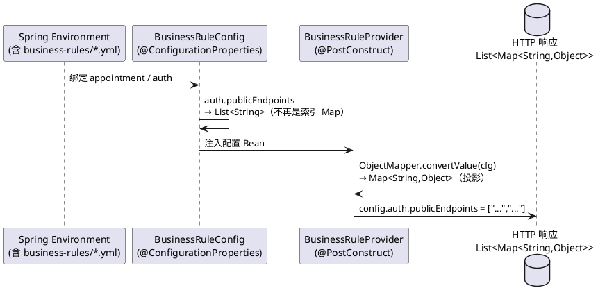

# 修复业务规则配置绑定缺陷，并让错误模型文档与实现对齐

> 日期：2026-11-06
>
> 关联需求：不涉及（本轮修的是实现与事实文档之间的既有偏差，偏差来源见 §1.1）
>
> 设计 design：docs/designs/topic/businessrule.md、docs/designs/topic/error-code.md
>
>
> **plan 一旦定稿就不修改。** 同一资源的二次改造新建 `YYYY-MM-DD-{slug}.md`，不修改原计划文件

## 1. 文档说明

### 1.1 背景

上一轮（`20261106-businessrule-datadictionary-api-tests.md`）补齐了 BusinessRule /
DataDictionary 的集成测试，runner 在无人值守下记录了 **3 项"发现但未修"**。
本轮把其中 2 项真正修掉，外加 1 项上一轮之后新核实的问题：

| # | 问题 | 性质 | 本轮处理 |
|---|---|---|---|
| 1 | `config.auth.publicEndpoints` 被序列化成 `{"0":"/api/v1/auth/**",...}` 而非 JSON 数组 | **实现缺陷** | 修（§11.1） |
| 2 | `AGENTS.md` §7 描述了一套不存在的错误模型 | **事实文档与实现不符** | 修（§11.3） |
| 3 | `config.auth.*` 的来源与 `docs/designs/topic/businessrule.md` 的"配置路径"列对不上 | **事实文档与实现不符** | 修（§11.3） |
| 4 | `docs/standards/error.md` 描述的 `IError` / `AbstractException` / `ErrorGroup` 体系在代码里 **完全不存在** | **事实文档与实现不符** | 修（§11.3） |
| 5 | 6 处引用 `docs/dev/design-fact/**` 的死链（该目录不存在） | **死链** | 修（§11.3） |

**问题 1 的根因**（已实测确认，不是猜测）：

`BusinessRuleConfig.auth` 声明为 `Map<String, Object>`，Spring Boot 的 binder 拿到 YAML 里的
**序列**（`publicEndpoints: ["...","..."]`）时，无法确定该绑成数组还是 Map，于是退化成
**以 0/1/2… 为键的 Map**。于是 Jackson 序列化出 `{"0":"...","1":"..."}` ——
下游任何按数组消费的客户端都会拿到错误结构。

同一份 `auth.yml` 里的 `password` / `token` 是纯标量子结构，绑成 Map 没问题。
**只有列表这一种形状会被绑坏。**

**问题 2/4 的根因**：`AGENTS.md` §7 与 `docs/standards/error.md` 描述的是一套
"照抄自别的项目"的错误模型 —— `BusinessException`、`IError`、`ErrorGroup`、
`{errorCode, message, timestamp}`。本仓库的代码里 **一个都不存在**。
实际实现是：

```
GlobalExceptionHandler（@RestControllerAdvice）
├── IllegalArgumentException        → 400 PARAM_ERROR
├── IllegalStateException           → 409 BUSINESS_CONFLICT
├── MethodArgumentNotValidException → 400 VALIDATION_ERROR
└── Exception（兜底）                → 500 SYSTEM_ERROR
响应体：ErrorResponse{errorCode, errorMessage, data}
```

新人按 §7 写代码会直接编译不过（`BusinessException` 不存在），
按文档里的示例 JSON 解析响应也会拿到 `null`（字段叫 `errorMessage` 不叫 `message`）。

关键决策点：

- **问题 1 改 `BusinessRuleConfig` 的类型声明，不改 YAML。**
  YAML 里的列表写法是 **正确且符合直觉的**（`publicEndpoints` 就是个列表），
  错的是 Java 侧用 `Map<String,Object>` 去接它。改 YAML 去迁就错误的类型声明是本末倒置。
- **问题 1 只把 `auth` 改成有类型的嵌套类，`appointment` 保持 `Map<String,Object>`。**
  `appointment` 当前全是标量子结构，没有列表，绑 Map 是安全的；把它也类型化要新增 4 个
  嵌套类、放大 diff 与回归面，而它今天 **没有暴露出任何问题**。留作后续。
- **问题 2/3/4/5 改文档，不改代码。** 代码是对的（`error-code.md` 的"当前实现映射"表
  已经如实记录了现状），错的是文档。

### 1.2 目标

- 实现目标：
  - `GET /api/v1/business-rules` 返回的 `config.auth.publicEndpoints` 是 **JSON 数组**
  - `AGENTS.md` §7 / §12 与 `docs/standards/error.md` 的错误模型描述与代码 **完全一致**
  - `docs/designs/topic/businessrule.md` 的"配置路径"列指向 **真实生效** 的配置来源
  - 仓库内不再有指向 `docs/dev/design-fact/**` 的死链
- 技术边界：
  - 生产代码改动 **限 2 个文件**：`BusinessRuleConfig`、`BusinessRuleProvider`
  - YAML 内容 **不改**
  - API 契约 **不改**（`docs/designs/api.yaml` 的 `config: {type: object}` 不动）
  - 前端、数据库、QA 用例 **不涉及**

---

## 2. 领域模型（PlantUML）

本轮 **无领域模型变更**。`BusinessRuleConfig` 的类型收紧属于配置绑定细节，
不改变任何聚合、值对象或状态机。

```plantuml
@startuml
skinparam classAttributeIconSize 0

class BusinessRuleConfig {
  - appointment : Map<String,Object>
  - auth : AuthConfig
}

class AuthConfig {
  - password : PasswordConfig
  - token : TokenConfig
  - publicEndpoints : List<String>
}

class PasswordConfig {
  - minLength : int
  - algorithm : String
}

class TokenConfig {
  - expirationMs : long
  - algorithm : String
}

BusinessRuleConfig *-- AuthConfig
AuthConfig *-- PasswordConfig
AuthConfig *-- TokenConfig
AuthConfig *-- "publicEndpoints : String" <<list>>
@enduml
```

---

## 3. 数据库设计（SQL DDL）

不涉及 —— 本轮目标接口不读写数据库，无表结构变更。

---

## 4. API 设计（OpenAPI）

**无契约变更。** `docs/designs/api.yaml` 里 `BusinessRuleResponse.config` 是
`{ type: object }`，本轮不细化它（细化属于契约变更，需另行评审）。

本轮修复后响应体的 **实际形状**（`config` 部分，现状 vs 修复后）：

```yaml
# 现状（publicEndpoints 是被绑坏的索引 Map）
config:
  auth:
    password: { minLength: 8, algorithm: BCrypt }
    token:    { expirationMs: 86400000, algorithm: HMAC-SHA256 }
    publicEndpoints: { "0": "/api/v1/auth/**", "1": "/api/v1/home/**", ... }

# 修复后（publicEndpoints 是真正的数组）
config:
  auth:
    password: { minLength: 8, algorithm: BCrypt }
    token:    { expirationMs: 86400000, algorithm: HMAC-SHA256 }
    publicEndpoints: [ "/api/v1/auth/**", "/api/v1/home/**", "/api/v1/consultants/**",
                       "/api/v1/data-dictionaries/**", "/api/v1/business-rules/**" ]
```

> `config.appointment` 子树保持原样（`conflict` / `slot` / `available` / `cancel`），
> 不在本轮变更范围内。

---

## 5. 时序图（PlantUML）



---

## 6. 专题设计（Markdown）

### 6.1 权限设计

不涉及 —— `GET /api/v1/business-rules` 仍是 `permitAll`，本轮不改鉴权。

### 6.2 并发控制

不涉及 —— `BusinessRuleProvider` 在 `@PostConstruct` 里一次性建缓存，之后只读。

### 6.3 事务设计

不涉及 —— 只读接口，无写操作、无事务边界变化。

### 6.4 异常处理

本轮 **不改任何异常处理**。

要改的是 **文档对异常处理的描述**。改完之后 `AGENTS.md` §7 必须能回答三个问题：

1. 有哪些异常 → 各自映射什么 HTTP 状态码与 errorCode？
2. 响应体长什么样？
3. 新代码该抛什么异常？

答案（以 `GlobalExceptionHandler` 当前实现为准）：

| 抛出什么 | HTTP | errorCode | 什么时候用 |
|---|---|---|---|
| `IllegalArgumentException` | 400 | `PARAM_ERROR` | 参数不合法、查不到的资源（消息即 `errorMessage`） |
| `IllegalStateException` | 409 | `BUSINESS_CONFLICT` | 业务状态冲突（如同一时段被占用） |
| `MethodArgumentNotValidException` | 400 | `VALIDATION_ERROR` | `@Valid` 字段级校验失败（自动抛出，不手写） |
| 其它 `Exception` | 500 | `SYSTEM_ERROR` | 兜底，消息固定为「系统繁忙」 |

响应体（`GlobalExceptionHandler.ErrorResponse` 这个 record 的实际字段）：

```json
{
  "errorCode": "BUSINESS_CONFLICT",
  "errorMessage": "该时段已被占用",
  "data": null
}
```

鉴权失败由 Spring Security 直接返回 **401 / 403**，**不走** `ErrorResponse` 包装。

### 6.5 性能设计

不涉及 —— 投影在 `@PostConstruct` 里做一次，运行时开销不变。

### 6.6 扩展性设计

**这条是本轮的核心收益。**

现在 `auth` 有了类型，`AuthConfig` 就是契约本身：

- YAML 里少写一个键 → 绑定时用类里的默认值，**不会静默丢字段**
- YAML 里多写一个键 → Spring Boot 绑定到未知属性时会 **fail fast**（取决于
  `ignoreUnknownFields`，默认 true 则是静默忽略 —— 所以 §6.7 要求 YAML 与类同时改）
- YAML 里把列表写错形状 → 类型不匹配，启动即报错，而不是像现在这样 **静默产出 `{"0":...}`**

`appointment` 保持 `Map<String,Object>`：它没有列表，今天是安全的；
但**如果将来往 `appointment.yml` 里加列表，会重现同一个 bug**。
本轮在 `docs/standards/business-rule.md` 里把这条约束写清楚（§11.3）。

### 6.7 一致性约束（必须遵守）

* **YAML 与 Java 类必须同时改。** `auth.yml` 的键结构 = `AuthConfig` 的字段结构，
  一一对应：
  * `auth.password.minLength` → `PasswordConfig.minLength`（`int`）
  * `auth.password.algorithm` → `PasswordConfig.algorithm`（`String`）
  * `auth.token.expirationMs` → `TokenConfig.expirationMs`（`long`）
  * `auth.token.algorithm` → `TokenConfig.algorithm`（`String`）
  * `auth.publicEndpoints` → `AuthConfig.publicEndpoints`（`List<String>`）
* **默认值必须与 YAML 一致。** 类里的字段默认值写死当前 YAML 里的值
  （8 / BCrypt / 86400000 / HMAC-SHA256 / 5 个端点），
  这样即使 YAML 加载失败，接口也不会返回"空壳"配置。
* **`appointment` 子树保持 `Map<String,Object>`**，其 YAML 键与值本轮 **一个字都不改**。
* **不改 YAML 文件内容**（`backend/src/main/resources/business-rules/*.yml`），
  只改它对应的 Java 类型声明。
* **不改 API 契约**：`docs/designs/api.yaml` 不动。
* **不改 `SecurityConfig`、`GlobalExceptionHandler`、`ErrorResponse`**。
* 命名：
  * 测试方法名 `should_{action}_{expectedResult}`
  * **不写 `TC-` 编号**（`TC-xxx` 是 QA 用例的编号体系，开发自测不进入编号空间，
    见 `AGENTS.md` §10）
* 归属：新增/修改的测试属于 **开发自测**（验证"代码按 Plan 的设计工作"），
  **不是 QA 测试**，不进 `docs/test-cases/e2e-cases/`，也不进 `e2e/tests/qa/`。

---

## 7. 单元测试设计

本轮 **不新增单元测试**。

`BusinessRuleProvider` 的投影逻辑由 §9 的集成测试经由 HTTP 端到端覆盖 ——
它依赖 Spring 的 binder 与 YAML 装载，脱离 Spring 上下文做单元测试意义有限
（且项目现有约定就是 API 层集成测试覆盖，见 `AGENTS.md` §10）。

---

## 8. 单元测试设计（补充：投影的内部契约）

不涉及。

---

## 9. API 集成测试设计

### 9.1 测试范围

* 切片类型：全链路集成（`@SpringBootTest(webEnvironment = RANDOM_PORT)` + RestAssured）
* 真实加载组件：Controller → AppService → `BusinessRuleProvider` → `BusinessRuleConfig` → YAML
* Mock 边界：**无**
* 继承 `com.consultation.TestBase`（沿用 `@BeforeEach` 的 `resetDbService.resetAll()`）

### 9.2 测试环境

* 数据库：MariaDB4j —— 本轮用例不读写
* 中间件：无；下游服务：无
* 迁移脚本：`spring.flyway.enabled=false`（test profile 已有）
* 鉴权：`permitAll`，用例不带 `Authorization` 头

### 9.3 用例覆盖场景

- [x] 契约校验：状态码、响应字段、错误返回结构
- [x] 鉴权场景：免鉴权可访问（`permitAll` 契约）
- [x] 业务闭环：不涉及（只读接口）
- [x] 数据一致性：YAML → 接口透出（`publicEndpoints` 数组化 + 标量不回归）
- [ ] 状态机 / 并发幂等 / 下游异常：不涉及（只读接口，无状态流转）

### 9.4 测试数据

* 数据准备：**不需要**。无 DB 写入
* 隔离策略：沿用 `TestBase.setUp()` 的 `resetDbService.resetAll()`
* 断言规范：**RestAssured + Hamcrest + 少量 Java 断言**

> ⚠️ **GPath 限制（上一轮踩过的坑）**
>
> RestAssured 5.3.2 走 Jayway/GPath，**`$[*]` 这类写法不被支持**，
> 且嵌套列表的展开行为不可靠。
> 本轮涉及列表的断言 **一律走 `jsonPath().getList("$")` 取出 `List<Map<String,Object>>`，
> 再用 Java 断言遍历**，不依赖 GPath 对嵌套列表的展开。

### 9.5 用例清单

#### 新增：`BusinessRuleControllerTest` 补 2 例

| # | 场景类型 | 用例说明 | 预期结果 | 关联章节 |
| :--: | :------: | :------ | :------ | :------ |
| 1 | 数据一致性 | `publicEndpoints` 是 JSON 数组 | 200；`config.auth.publicEndpoints` 是 `List`（**不是 Map**）；长度 5；含 `/api/v1/auth/**`、`/api/v1/business-rules/**`；每项以 `/api/v1/` 开头 | §6.6 §6.7 |
| 2 | 数据一致性 | `auth` 下的标量配置未被类型化改动破坏 | 200；`config.auth.password.minLength == 8`、`password.algorithm == "BCrypt"`、`token.expirationMs == 86400000`、`token.algorithm == "HMAC-SHA256"` | §6.7 |

用例 2 是 **防回归锚点**：把 `Map` 换成有类型的类时，最容易出的错就是
数字类型被 Jackson 变成另一种数值类型、或字段名拼错 —— 用例 1 断言不出这类问题。

**合计 2 个新增用例。** 现有 5 例保持不变（`should_expose_yaml_config_for_each_rule`
里的 `config.appointment.slot.minMinutes` 与 `config.auth.token.expirationMs` 断言
在改造后必须 **继续通过** —— 这是天然的回归网）。

---

## 11. 修改清单

### 11.1 代码修改

| 操作 | 文件 | 改动 |
| :--: | :-- | :-- |
| 改 | `backend/src/main/java/com/consultation/domain/businessrule/BusinessRuleConfig.java` | `auth` 由 `Map<String,Object>` 改为有类型的嵌套类 `AuthConfig`（含 `PasswordConfig` / `TokenConfig` / `List<String> publicEndpoints`）；`appointment` 保持 `Map<String,Object>` |
| 改 | `backend/src/main/java/com/consultation/infrastructure/config/BusinessRuleProvider.java` | 注入 `ObjectMapper`，在 `@PostConstruct` 里把 `BusinessRuleConfig` 投影为 `Map<String,Object>` 后再挂进 `config`，保证对外返回结构不变（除 `publicEndpoints` 变回数组） |

> **为什么投影放在 Provider（infrastructure）而不是让 domain 直接返回 POJO**：
> `BusinessRuleConfig` 在 `domain` 层，`AGENTS.md` §3 要求 domain 不依赖基础设施；
> 而 JSON 形状是基础设施关注点。所以 domain 保持纯 Java 类型，
> 由 infrastructure 用 `ObjectMapper` 做投影，对外契约
> `List<Map<String,Object>>` **一个字都不变**，
> `BusinessRuleAppService` / `BusinessRuleController` **不需要改**。

### 11.2 接口变更

无。

### 11.3 文档修改

| 操作 | 文件 | 改动 |
| :--: | :-- | :-- |
| 改 | `AGENTS.md` §7 | 按 `GlobalExceptionHandler` 实际实现重写错误模型：4 条异常映射表 + 真实响应体 `{errorCode, errorMessage, data}`；删除不存在的 `BusinessException` / `APPOINTMENT_CONFLICT` / `message` / `timestamp` |
| 改 | `AGENTS.md` §12 | 检查清单里「业务校验使用 `BusinessException`」改为实际异常类型（`IllegalArgumentException` / `IllegalStateException`）；3 条 `docs/dev/design-fact/**` 死链改指 `docs/designs/**` |
| 改 | `docs/standards/error.md` | 删除 `IError` / `ErrorGroup` / `AbstractException` 异常类层次（代码里不存在）；换成 §6.4 的实际映射表；错误码表指向 `docs/designs/topic/error-code.md`（修死链） |
| 改 | `docs/standards/business-rule.md` | 结尾死链 `docs/dev/design-fact/others/businessrule.md` → `docs/designs/topic/businessrule.md`；补一条约束：**只有列表会被 `Map<String,Object>` 绑坏**，将来往 YAML 加列表前必须先给对应配置类加类型 |
| 改 | `docs/standards/data-dictionary.md` | 结尾死链 `docs/dev/design-fact/others/data-dict.md` → `docs/designs/topic/data-dict.md` |
| 改 | `docs/designs/topic/businessrule.md` | 认证规则表的「配置路径」列改为真实来源（`auth.yml → token.expirationMs` 而非 `application.yml → jwt.expiration`；`auth.yml → password.algorithm` 而非 `SecurityConfig (hardcoded)`） |

### 11.4 文档同步检查

| 文档 | 是否需要更新 | 理由 |
|---|---|---|
| `docs/designs/api.yaml` | **不涉及** | 无 API 契约变更（`config` 仍是自由 object） |
| `docs/designs/db-schema.md` | **不涉及** | 无表结构变更 |
| `docs/designs/topic/businessrule.md` | **已更新** | 配置路径列与实现对齐（§11.3） |
| `docs/designs/topic/data-dict.md` | **不涉及** | 字典定义未变 |
| `docs/designs/topic/error-code.md` | **不涉及** | 其"当前实现映射"表已如实记录现状，无需改 |
| `docs/test-cases/e2e-cases/test-cases.md` | **不涉及** | 属开发自测，不是 QA 用例；无新需求、无验收标准变化 |
| `docs/standards/error.md` | **已更新** | 见 §11.3 |
| `docs/standards/business-rule.md` | **已更新** | 见 §11.3 |
| `docs/standards/data-dictionary.md` | **已更新** | 见 §11.3 |
| `AGENTS.md` | **已更新** | §7 / §12，见 §11.3 |

---

## 12. 验证步骤

1. **基线（改动前）**：`cd backend && mvn -o -B test` → 期望 `Tests run: 28, Failures: 0, Errors: 0`
2. **实现后**：`cd backend && mvn -o -B test` → 期望 `Tests run: 30, Failures: 0, Errors: 0`
   （28 基线 + 2 新增）
3. **只看新用例**：`cd backend && mvn -o -B test -Dtest='BusinessRuleControllerTest'`
   → 期望 `Tests run: 7, Failures: 0, Errors: 0`（原 5 + 新 2）
4. **确认没碰不该碰的**：
   * `git status --short` → 只应出现 §11.1 / §11.3 列出的文件
   * `git diff -- backend/src/main/resources/business-rules/` → **必须为空**（YAML 不改）
   * `git diff -- backend/src/main/java/com/consultation/adapter/` → **必须为空**
   * `git diff -- backend/src/main/java/com/consultation/application/` → **必须为空**
   * `git diff -- docs/designs/api.yaml` → **必须为空**
5. **确认死链已清**：`grep -rn "design-fact" --include="*.md" . | grep -v "docs/plans/"`
   → 无输出（`docs/plans/` 下会命中本 Plan 自身对死链路径的引用，属正常）
6. **确认文档里的错误码与代码一致**：
   `grep -rn 'new ErrorResponse("' backend/src/main` 的 4 个错误码，
   与 `AGENTS.md` §7 表格逐条对得上
7. **确认没有引入 `TC-` 编号**：`grep -rn "TC-" backend/src/test/` → 无输出

---

## 13. 风险与回滚

* **风险点 1：类型化后默认值与 YAML 不一致。**
  缓解：`AuthConfig` 各字段默认值 **写死当前 YAML 的值**；
  用例 2 会断言实际透出的值，任何一边改了另一边没跟上都会红。

* **风险点 2：`ObjectMapper` 投影改变了数值类型。**
  例：`expirationMs` 若声明成 `int` 而非 `long`，大数会溢出；
  `minMinutes` 若声明成 `String`，JSON 里会变成 `"30"`。
  缓解：用例 2 用 `((Number) x).intValue()` 取值再断言，
  既能挡住类型漂移，又不受 Integer/Long 装箱差异影响。

* **风险点 3：投影把 `appointment` 子树也洗了一遍。**
  `appointment` 本来就是 `Map<String,Object>`，Jackson 往返后值类型可能从
  `Integer` 变 `Integer`、从 `String` 变 `String`（不变），
  但理论上可能出现 `LinkedHashMap` → `LinkedHashMap` 的键序变化。
  缓解：现有用例 `should_expose_yaml_config_for_each_rule` 断言
  `config.appointment.slot.minMinutes == 30`，它必须继续通过；
  若它变红，说明投影方式选错了 —— **此时应改实现，不是改断言**。

* **风险点 4：`publicEndpoints` 变数组属于"对外可见的行为变更"。**
  下游若已按 `{"0":...}` 消费，改完会坏。
  但 `{"0":...}` 从来不是任何文档承诺过的形状（`api.yaml` 只说 `config: {type: object}`），
  且当前没有任何消费方依赖这个形状（已核实：`frontend/src` 无引用；
  `e2e/tests/qa/app.spec.ts` 的 TC-004 只断言该接口 HTTP 200，不读 `config`）。
  结论：**属于修 bug，不是破坏兼容**。

* **回滚方案**：
  生产代码改动集中在 2 个文件，`git checkout` 这 2 个文件即可完全回滚；
  测试是新增 2 例，删除即可；文档改动可单独回滚。
  全程无 DDL、无数据迁移、无配置中心变更，**回滚零副作用**。

---

## 14. 实施后需更新的 design 文档

见 §11.3（`docs/designs/topic/businessrule.md` 已列入本轮修改清单）。

---

## 15. 变更记录（可选）

| 版本 | 日期       | 变更内容 |
| ---- | ---------- | -------- |
| v1.0 | 2026-11-06 | 初始版本 |
